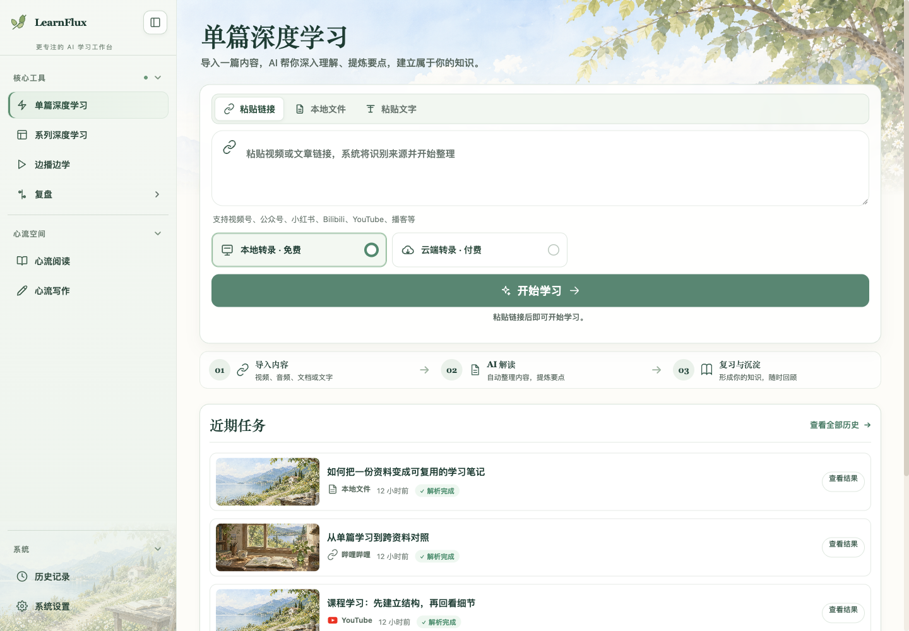
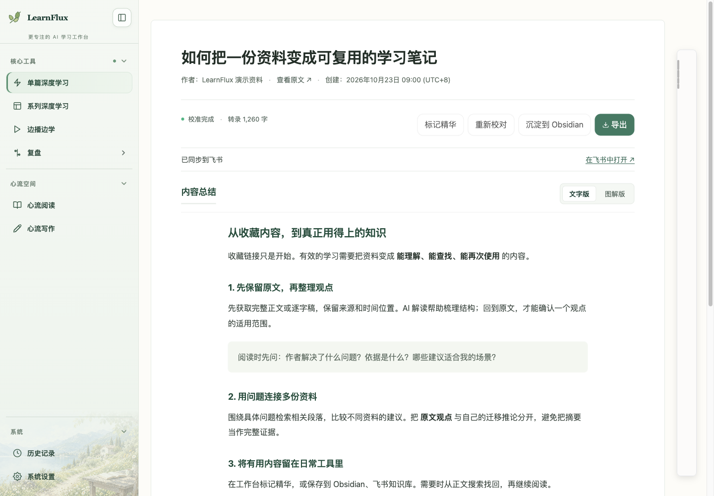
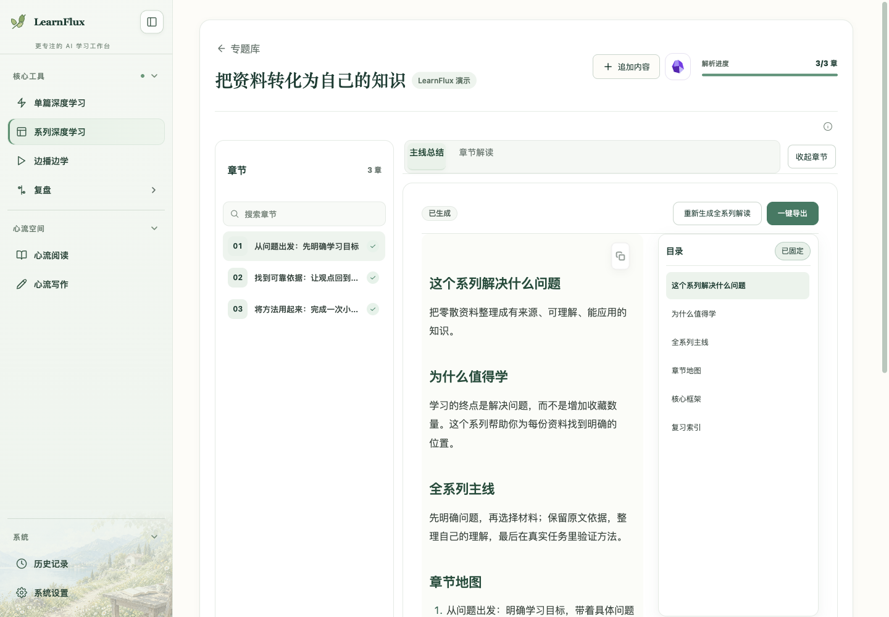
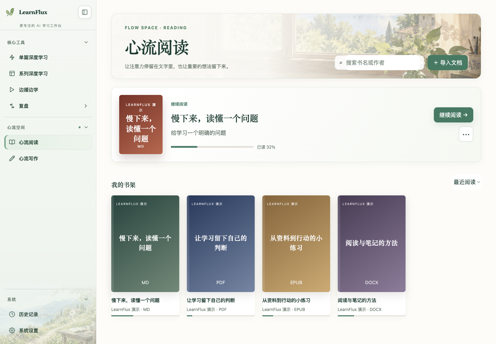
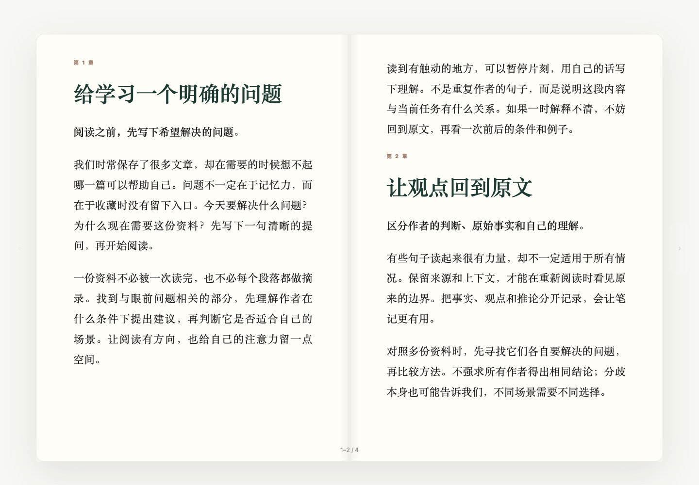
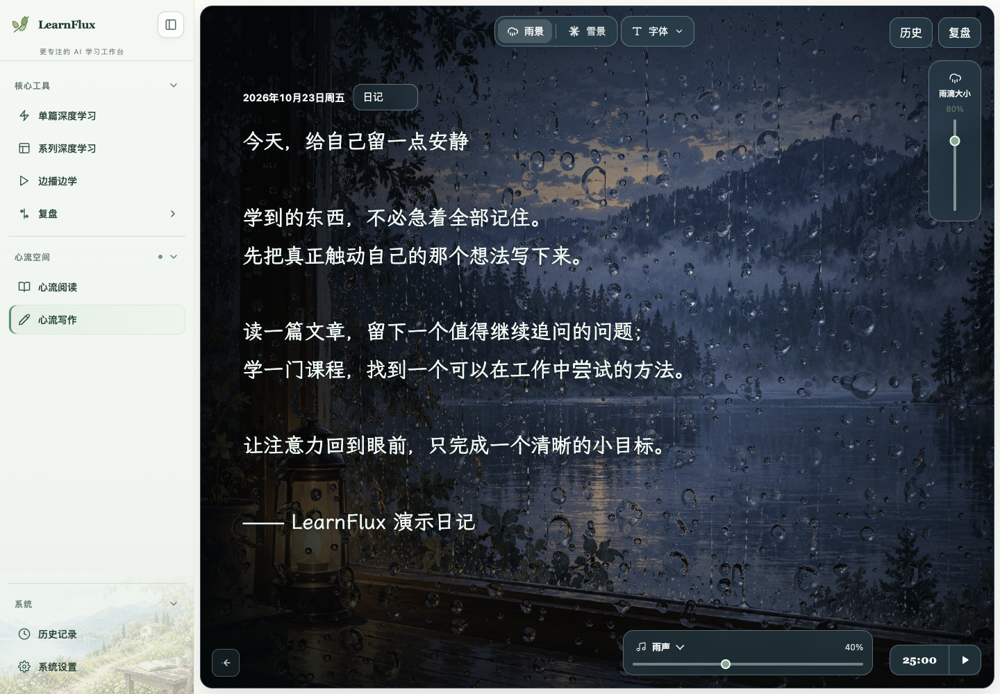
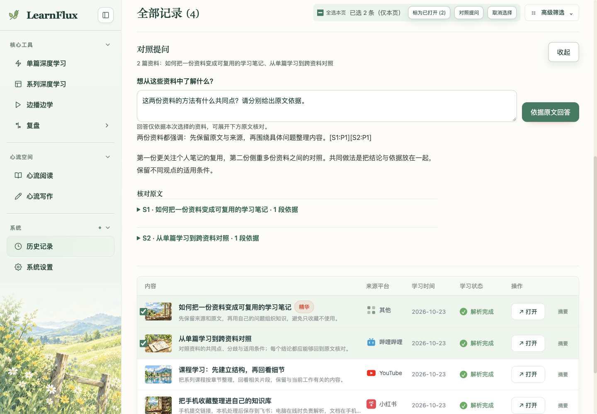

# LearnFlux

> 把视频、音频和文档，变成读得懂、查得到、用得上的知识。

LearnFlux 是可自托管的 **AI 学习工作台**。给它一个链接、一份文件或一段文字，整理出正文 / 逐字稿和 AI 解读；继续围绕原文提问、对照多份资料，并把有用的内容留在 Obsidian 或飞书。

**导入内容 → 获取原文 → AI 理解 → 核对与筛选 → 保存到自己的知识库**

> **版本说明（2026-10-23）**：本次发布 README、截图和使用文档。正文检索、带出处的跨资料问答、普通链接任务重启恢复、飞书文档读取，以及新版结果排版与交付状态，仍在本地开发工作区，尚未合入 `main`。下文将这些能力标为“开发中”；仅克隆 `main` 不会自动获得它们。

[快速开始](#快速开始) · [核心功能](#核心功能) · [页面与用法](#页面与用法) · [服务配置提示词](#按需配置服务给-agent-的提示词) · [文档中心](docs/README.md)

[](https://www.python.org/downloads/)
[](https://fastapi.tiangolo.com/)
[](LICENSE)

<p align="center">
  
</p>

截图更新于 **2026-10-23**，由当前工作区的页面、模板和静态资源在浏览器中渲染截取。记录、正文、问答与交付状态使用演示数据，展示操作和排版；不包含个人资料、真实令牌，也不代表第三方服务已替新用户配置完成。截图不使用旧版设计稿。

## 核心功能

| 你想完成的事 | LearnFlux 怎么帮你 |
| --- | --- |
| **快速读懂一篇内容** | 导入平台链接、本地音视频、文档或文字；获取原文、校对转录并生成结构化解读。 |
| **学完一门课或一个专题** | 按系列组织资料，批量处理课程与本地目录，回看章节，生成全系列解读和知识地图。 |
| **安静地读完一份文档** | 在心流阅读书架管理文档、接着上次进度阅读，进入双页 / 单页阅读器，按目录或正文搜索定位。 |
| **把想法写成自己的内容** | 在心流写作中记录日记和笔记，选择雨景 / 雪景、背景音与字体，配合专注计时，并导出 TXT / Markdown。 |
| **带着问题看资料（开发中）** | 长资料问答检索相关原文段落；从历史页选择 **2–5 份资料**对照提问，展开依据并回到来源核对。 |
| **找回学过的内容** | 按标题、作者及来源、时间、状态查找，标记精华；正文搜索与命中片段为最新开发能力。 |
| **在手机上收集** | iPhone 快捷指令把剪贴板链接发送到自己的本地工作台；后台解析，任务进度和结果可回看。 |
| **把成果保存下来** | 同步到本机 Obsidian Vault，或自动保存为飞书知识库文档；结果页交付状态和打开入口开发中。 |

音视频内容还可以在 **边播边学** 中联动播放、字幕与笔记；复盘模块支持按日、周、月、年继续整理学习和生活记录。

### 支持哪些来源

- **平台内容**：YouTube、Bilibili、抖音、小红书、小宇宙、微信视频号等；支持原生字幕优先和下载后转录。
- **自己的文件**：本地视频、音频；PDF、EPUB、DOCX、TXT、Markdown 等阅读文档，以及已有文字。
- **飞书文档（开发中）**：经本机 CLI 授权读取 Wiki / Docx 正文，直接走文本学习，不做音视频转录。[读取范围与配置](docs/guides/feishu-documents.md)

平台能力有各自前置条件：抖音、小红书等社媒来源通常需要 TikHub；视频号可能需要独立解密服务；部分来源需要登录或特定网络环境。平台限流、失效链接和权限限制仍会影响获取，不能保证任意链接都可解析。

## 页面与用法

### 1. 导入：从一篇内容开始

打开 **单篇深度学习**，选择“粘贴链接 / 本地文件 / 粘贴文字”，提交后在近期任务查看进度。第一次建议用一段短文本验证 AI 配置，再尝试短音视频；文字学习不需要安装转录模型。

处理在后台运行，不需要一直停留在提交页。最新开发版还为新提交的普通本地链接任务保存恢复信息，服务重启后按规则恢复；这项能力尚未合入 `main`，上传任务和云端任务也不会一律自动重放。

### 2. 理解：读总结，也能核对原文

结果页可以标记精华、查看校对文本、导出，或保存到已配置的知识工具。下图展示最新开发版的分层排版，区分标题、章节、正文、强调和引用，并适配暗色与窄屏；新版排版尚未合入 `main`。

<p align="center">
  
</p>

飞书自动归档可按需配置。最新开发版另增加“等待同步 / 正在校验 / 已同步 / 需要核对”等页面状态、安全重试与同文档更新保护；这些增强尚未合入 `main`。[归档与版本边界](docs/guides/feishu-archive.md)

### 3. 系列深度学习：把一门课串成一条主线

打开 **系列深度学习**（`/collections`），建立课程 / 专题，导入课程资料或选择本地目录。处理完成后，左侧按章节回看，右侧在“主线总结”和“章节解读”之间切换；全系列解读把课程目标、章节关系和核心方法整理在一起。

下图展开了章节列表，可搜索章节、查看各节进度，也可以导出全系列解读或同步到已配置的 Obsidian。

<p align="center">
  
</p>

### 4. 心流阅读：从自己的书架，进入沉浸阅读

打开 **心流阅读**（`/reading`），导入 PDF、EPUB、DOCX、TXT 或 Markdown。书架显示文档与阅读进度，点击“继续阅读”回到上次的位置，也可按书名或作者搜索。

<p align="center">
  
</p>

进入阅读器后，以单页或双页排版阅读；需要时展开目录、搜索正文、调整主题与字号，或选择背景音。下面展示双页阅读状态，让正文成为画面中心。

<p align="center">
  
</p>

### 5. 心流写作：给想法留一个安静的位置

打开 **心流写作**（`/static/focus-studio.html`），直接写日记、学习笔记或草稿。雨景 / 雪景、背景音、字体和字号可自行调整；右下角有专注计时，写作内容自动保存，并可导出 TXT 或 Markdown。

下图使用当前雨景模式和演示日记，保留实际的氛围控制与写作区域。

<p align="center">
  
</p>

### 6. 历史记录：把最近学过的内容“晾”出来

打开 **历史记录**（`/static/history.html`），顶部以绳夹卡片展示“最近学习”，左右浏览即可回到那份内容；下方用列表保留全部记录，按来源平台、内容类型、时间和状态筛选，也可标记精华。

这张截图完整保留了“晾衣架”设计、卡片封面、来源标识，以及下方的记录列表，方便了解怎样继续学习和查找历史。

<p align="center">
  
</p>

### 7. 查找与对照：从原文里找答案（开发中）

在 **历史记录** 搜索标题、作者或正文。勾选同一页内 **2–5 条已完成记录**，点击“对照提问”，例如：

> 这几位作者的方法有什么区别，各自适合什么场景？请给出原文依据。

回答附资料和段落编号，“核对原文”可展开相关内容并跳回资料位置。检索使用本地词语匹配；长文只把相关段落或明确说明的抽样交给模型，找不到依据时会提示，不承诺模型判断永远正确。

<p align="center">
  
</p>

### 8. 手机：随手收集，在飞书阅读

**复制链接 → 运行快捷指令 / 轻点背面 → 本地后台解析 → 自动保存到飞书 → 手机打开文档**

这条路径需要分别启用手机入口与飞书归档，不依赖云端 Agent 或飞书群扫描。Mac **锁屏可以继续运行**，但休眠、关机、退出登录、断网会影响处理；没有云端收件箱时，电脑离线的提交需要重试。已保存到飞书的文档可独立在手机阅读。

配置方法见[手机快捷指令](docs/guides/mobile-shortcut.md)和[飞书归档](docs/guides/feishu-archive.md)，也可直接复制下方对应的 Agent 提示词。

## 快速开始

推荐首次体验环境：**Apple Silicon Mac + 本机 Whisper + 一个有效的大模型 API**。只处理文字 / 文档时，不必先部署 ASR。新安装默认使用本地 SQLite 与文件，不需要先装 PostgreSQL。

### 推荐：让 Agent 帮你安装

把以下整段复制给 **Codex、Claude Code、WorkBuddy 等能操作本机终端的 Agent**。它会识别环境、复用已有配置并逐项验证；需要你私下填写密钥或完成授权的地方会明确列出。

```text
请在我的电脑上安装并启动 LearnFlux，完成到可以实际使用。我授权安装缺少的项目依赖；涉及管理员权限、新建付费服务或开放公网时先说明。

1. 先阅读 https://github.com/zhangxun-ai/LearnFlux 的 README、AGENTS.md 和 scripts/bootstrap.sh。
   已有仓库就复用，没有再克隆；保留已有配置、数据、虚拟环境和正在运行的服务。
2. 检查操作系统、CPU 架构、磁盘、Git、Python、uv、FFmpeg 与端口。
   使用仓库固定的 Python 版本；安装缺少的依赖后检查当前终端的 PATH。
3. Apple Silicon Mac 优先使用本机 mlx-whisper。
   先检查已有安装；需要新装时使用 bash scripts/bootstrap.sh --with-local-whisper，并在配置中启用 local_whisper、填写实际可执行文件路径。
   脚本只安装依赖，首次转录还会下载模型，请先告知磁盘和下载要求。
4. Intel Mac、Linux、Windows 不套用 MLX 安装。
   先核对当前转录策略与平台支持；可以先跑通文本学习。
   若音视频路径尚不兼容，明确说明，不把网页能打开当成转录可用。
5. 仅在 config/config.jsonc 不存在时从模板创建。
   为新配置生成随机 api.auth_token，默认只监听 127.0.0.1，个人本机开启 browser_local_auto_login。
   密钥仅在本机保存和使用，不输出到聊天、终端、截图或 Git。
6. AI 解读需要有效的 LLM API Key、Base URL 和模型。
   检查配置是否齐全，缺少时告诉我应在本机设置页填写哪些字段；不要要求我把密钥发到聊天。
   TikHub 仅在需要对应社媒来源时配置，PostgreSQL、飞书、隧道和云端 ASR 都不作为基础安装前置项。
7. 在仓库根目录使用 ./server.sh start；需要前台排错时用 uv run python main.py --start。
   端口被占用时识别已有服务，不擅自结束进程；不要重复创建启动项。
8. 打开本地工作台，检查 /health 并解释异常组件。
   已有 LLM 配置时，用不含隐私的短文本完成一次学习；启用本地转录后另用我允许的短音频验证实际结果。
   不要未经确认调用付费云端 ASR。
9. 分别汇报“页面启动、AI 学习、本机转录”哪些已验证，给出访问地址和仍缺少的配置。
   需要密钥或人工授权才继续的步骤，明确列出，不声称全部成功。
```

[单独打开这份安装提示词](docs/prompts/macos-local-quick-start.md)。推荐路径不等于所有系统都已完成安装验收：Intel Mac、Linux、Windows 需按实际转录引擎和依赖核对；当前“本地转录”入口主要面向 MLX，不能直接把 CapsWriter 地址填上就视为等价支持。

### 手动安装（Apple Silicon Mac）

准备 Git；安装 FFmpeg 时需要 Homebrew。Python 运行环境与依赖由 uv 管理，仓库当前固定 Python 3.11。

```bash
git clone https://github.com/zhangxun-ai/LearnFlux.git
cd LearnFlux
bash scripts/bootstrap.sh --with-local-whisper
```

脚本会安装 uv（缺少时）、FFmpeg、项目依赖和本机 Whisper 包，仅在主配置不存在时创建 `config/config.jsonc`。它**不会自动启用 Whisper、申请 API Key 或配置独立服务**；首次实际转录还需下载模型。如果新装的 uv 未进入当前终端 PATH，请重新打开终端或使用其实际路径。

随后编辑 `config/config.jsonc`，保留模板其他字段，至少检查：

| 配置 | 本地首次使用怎么填 |
| --- | --- |
| `api.auth_token` | 将占位值改为自己生成的强随机口令，勿上传仓库。 |
| `api.host` | 个人本机建议 `127.0.0.1`。 |
| `api.browser_local_auto_login` | 个人本机保留 `true`，同源直连浏览器可自动建立会话。 |
| `local_whisper.enabled` / `binary` | 音视频转录时启用，并使用安装输出的实际 `mlx_whisper` 路径。 |
| `llm.api_key` / `base_url` / 模型字段 | AI 校对、总结、问答需要有效配置；也可启动后在系统设置中填写。 |

字段和 Key 获取入口见[配置指南](docs/guides/configuration.md)。个人 Mac 同时配置手机用户时，可按[本机免口令说明](docs/guides/mobile-shortcut.md#本机免口令)开启本机管理访问；远程和 API 请求仍鉴权。共享或多用户环境不要直接套用个人模式。

在仓库根目录启动：

```bash
./server.sh start
./server.sh status
curl http://localhost:8000/health
```

前台排错使用 `uv run python main.py --start`。默认访问：

- 工作台：<http://localhost:8000/add_task_by_web>
- 设置：<http://localhost:8000/settings>
- API 文档：<http://localhost:8000/docs>

macOS 的 `server.sh` 使用用户 LaunchAgent 管理后台运行，登录后启动。配置修改后先检查在途任务，再执行 `./server.sh restart`。

**首次验收**：页面可打开 → 短文本完成 AI 解读 → 短音视频出现可读逐字稿。`/health` 只说明受检组件状态，**不会完整验证 LLM、模型下载或一次真实转录**；未安装 ASR 时可能降级，但不应据此把文本学习误判为不可用。

## 按需配置服务：给 Agent 的提示词

不必把下列服务全部安装。先跑通一次学习，再按来源和阅读习惯添加。

提示词要求 Agent 先核对当前分支的实际实现。标为开发中的能力尚未随本次文档发布；仅安装服务或保存配置不会补齐缺少的功能代码。

| 组件 | 什么时候需要 | 是否必须 |
| --- | --- | --- |
| LLM API | AI 校对、解读、问答；密钥在本机填写 | 使用 AI 时需要，可能产生服务商费用 |
| 本机 Whisper / ASR | 无可用字幕的音视频转录 | 纯文字学习不需要；MLX 仅 Apple Silicon |
| TikHub | 抖音、小红书等相应来源 | 按需，有独立 Key 和服务商计费 |
| 飞书 CLI | 读取飞书文档 / 自动保存到知识库 | 可选，须用户登录与文档权限 |
| Cloudflare Tunnel | 手机在外网向本地提交链接 | 可选，须域名 / 隧道配置 |
| Obsidian | 保存到本机 Vault | 可选，不附带手机云同步 |
| FunASR / CapsWriter | 说话人识别 / 独立转录服务 | 按需，先核对当前调用路径与平台兼容性 |
| PostgreSQL / S3 | 自选数据库与对象存储后端 | 可选，新安装不要求 |

<details>
<summary><strong>我要自动保存到飞书知识库：复制此提示词</strong></summary>

```text
请为已运行的 LearnFlux 配置“完成后自动保存到飞书知识库”。先读 AGENTS.md、docs/guides/feishu-archive.md、docs/guides/feishu-documents.md 和 config/feishu_archive.example.json。

复用本机已有飞书 CLI；没有时查阅其当前官方安装与授权说明，只安装所需 CLI，不安装云端 Agent。登录和授权由我本人完成，禁止提取或输出令牌。

向我确认目标知识库链接和本地任务所属身份，确认有写权限。使用独立 API 用户且 user_id 与网页资料库一致；归档配置放私人目录，since 设为本次启用时间，不默认上传全部历史任务。设置 LEARNFLUX_FEISHU_ARCHIVE_CONFIG 指向同一配置，保留所有已有密钥与资料。

运行独立 scripts/feishu_archive_worker.py，并在我的系统支持时配置用户级自启动；保持本地业务数据库与归档状态库分离。用我同意的一条无隐私结果验证：只创建一篇文档、正文与解读完整、回读通过；当前分支具有交付状态接口时，再验证结果页显示与打开入口。缺少开发中的接口时明确报告，不声称页面能力已启用。重复运行不新增文档；人工修改不得被强制覆盖。

最后给我飞书手机查看方式、后台运行状态和停用方法。只配置这一集成，不开放知识库分享，不部署公网站点。
```

</details>

<details>
<summary><strong>我要用 iPhone 快捷指令收集：复制此提示词</strong></summary>

```text
请为已运行的 LearnFlux 配置“iPhone 快捷指令 → 本地后台解析”。先读 AGENTS.md 和 docs/guides/mobile-shortcut.md。

复用已有域名和 Cloudflare Tunnel；缺少域名或登录授权时由我提供并确认，不自动购买。安装缺少的 cloudflared，只为我指定的子域名建立 HTTPS 收集入口，精确放行 /api/transcribe，其余路径返回 404，不直接公开设置或文件接口。

生成手机专用随机 Bearer Token，保留本地资料身份，使 user_id 与网页所有者一致。凭据仅在私人配置和我自己的快捷指令内使用，不在聊天、日志、截图或公开文件里展示。个人机器同时配置手机用户时，按指南保持本机管理会话自动恢复。

在可操作的快捷指令 App 内完成配置：获取剪贴板 → 提取 URL → 取第一项 → POST 到 https://<我的子域名>/api/transcribe；JSON 的 url 使用第一项变量，transcription_strategy 设为 local。通知只表示快捷指令已执行，不误报解析成功。

配置本地服务和隧道的用户级自启动。先验证无凭据拒绝、有效请求受理、其他公网路径拒绝、本地结果可读，再请我用手机移动网络实测。不要调用付费云端 ASR。说明锁屏与休眠的区别、电脑离线时如何重试，以及如何停用入口。
```

</details>

<details>
<summary><strong>我要配置其他转录服务：复制此提示词</strong></summary>

```text
请根据我的系统和音视频需求，核对 LearnFlux 当前转录路径，帮我配置最少的必要服务。先阅读 AGENTS.md、scripts/bootstrap.sh、config/config.example.jsonc 和 transcriber/providers 的实际实现。

Apple Silicon 优先复用本机 mlx-whisper；其他系统先确认显式 local 策略的兼容性，不能只填 CapsWriter 地址就声称可用。需要 CapsWriter 或 FunASR 时，查阅对应服务当前官方部署说明，核对硬件、下载量、依赖与 WebSocket 地址；FunASR 仅在我需要说话人识别时安装。

保留已有环境与服务，不自动启用云端 ASR，不开公网端口。若当前代码不支持我的平台或所选策略，先说明缺口和最小解决方案，不擅自改业务代码。配置后用我允许的短音频验证真实转录和可读结果，分别报告服务连通性与实际识别效果。
```

</details>

LLM / TikHub 通常是填写已有服务凭据，按[配置与 API Key 指南](docs/guides/configuration.md)操作；本地转录不产生云端 ASR 费用，**不代表 LLM、TikHub 等第三方调用免费**。云端 ASR 默认关闭，启用后仍先估算、确认再提交。

## 部署、API 与开发

<details>
<summary><strong>常用命令与 API 示例</strong></summary>

```bash
./server.sh status
./server.sh log
./server.sh restart
./server.sh stop
```

```bash
curl -X POST "http://localhost:8000/api/transcribe" \
  -H "Authorization: Bearer <YOUR_TOKEN>" \
  -H "Content-Type: application/json" \
  -d '{"url":"<SOURCE_URL>","use_speaker_recognition":false,"transcription_strategy":"local"}'
```

接口返回任务身份后在后台处理，受理不等于完成。[完整 API 流程](docs/guides/api/quickstart.md) · [给 Agent 调用的 skill](skill/README.md)

</details>

<details>
<summary><strong>其他部署方式、数据与开发</strong></summary>

- **数据库**：新环境默认 SQLite，可选 PostgreSQL；已有部署以实际环境为准。切换前遵循[迁移与回滚指南](docs/guides/postgresql.md)。
- **Docker**：仓库提供 [Compose](docker/docker-compose.yml)，默认宿主机 8200 → 容器 8000；独立 ASR 不包含在应用容器内。镜像有架构相关依赖，应核对构建日志和所选转录路径，不视为通用跨平台一键包。
- **数据与访问**：配置、数据库、媒体、日志留在自己的环境；第三方 AI、解析 API 与飞书会按启用的能力处理相应内容。`view_token` 是结果页访问凭据，不公开真实结果 URL 或截图中的令牌。不要提交 `.env`、真实配置或用户数据。
- **公网**：需 HTTPS、鉴权与入口限制；手机仅收集场景按手机指南收窄路径。没有集成的云端离线收件箱。
- **Python 包名**：产品名为 LearnFlux，包名仍为 `video_transcript_api`，以兼容现有调用。

```bash
uv sync --extra dev
uv run --extra dev pytest tests/unit
uv run --extra dev pytest
```

集成、平台、LLM 和性能测试按需显式运行，可能访问网络、媒体或收费服务。测试分层见 [tests/README.md](tests/README.md)。

</details>

## 常见问题

| 遇到的问题 | 从这里开始 |
| --- | --- |
| 页面打不开 | 检查 `server.sh status`、实际端口和启动日志。 |
| 有原文，没有 AI 解读 | 检查 LLM Key、Base URL、模型名；改配置后按需重启。 |
| 音视频一直无法转录 | 检查所选策略、本机模型 / ASR 服务；用短音频单独验证。 |
| 抖音 / 小红书失败 | 检查 TikHub 配置、链接有效性、平台权限与限流。 |
| 本机反复要管理口令 | 核对本机直连地址、自动会话配置，以及是否启用了多用户模式。[说明](docs/guides/mobile-shortcut.md#本机免口令) |
| 手机显示已执行，工作台没结果 | 通知不等于受理成功；检查电脑在线、隧道、身份归属和任务记录。 |
| 飞书没有收到文档 | 检查独立归档进程；开发版可另查看结果页交付状态。已有人工编辑时先核对，不强制覆盖。 |

## 文档

| 文档 | 内容 |
| --- | --- |
| [文档中心](docs/README.md) | 用户与开发文档导航 |
| [配置与 API Key](docs/guides/configuration.md) | 配置位置、字段、凭据来源 |
| [本地安装提示词](docs/prompts/macos-local-quick-start.md) | 可单独复制给编程 Agent 的安装任务 |
| [手机快捷指令](docs/guides/mobile-shortcut.md) | 隧道、独立令牌、自启动与移动网络验收 |
| [飞书知识库归档](docs/guides/feishu-archive.md) | 自动交付、完整性、重试与人工修改保护 |
| [飞书文档读取](docs/guides/feishu-documents.md) | 授权读取 Wiki / Docx 正文 |
| [API Quick Start](docs/guides/api/quickstart.md) | 认证、提交、轮询与结果读取 |
| [系统架构](docs/architecture.md) | 模块与处理流程 |
| [PostgreSQL 指南](docs/guides/postgresql.md) | 迁移、验收与回滚 |

## 项目来源与致谢

LearnFlux 基于 [VideoTranscriptAPI](https://github.com/zlxlabs/VideoTranscriptAPI) 的早期版本持续演进而来。感谢原作者 [@zj1123581321](https://github.com/zj1123581321) 提供的视频解析、转录与 API 基础实现。

本仓库保留了原项目的 Git 提交历史，以及对应的版权和许可声明。LearnFlux 在此基础上继续扩展 AI 学习、系列知识、阅读写作、Obsidian 同步等能力。

## AI 辅助开发说明

本项目开发过程中使用 OpenAI Codex 协助代码生成、重构、测试和文档整理。产品方向、技术决策、代码审查、发布与维护由项目维护者负责。

## 许可证

本项目使用 **MIT License + Commons Clause**。

- 允许个人学习、研究、修改和符合条款的分发。
- Commons Clause 不授予销售本软件，或以本软件主要功能向第三方收费的权利，包括相关托管、咨询和支持服务。

这不是不受限制的标准 MIT 商业授权。使用前请阅读完整的 [LICENSE](LICENSE)。

## 反馈与贡献

欢迎通过 [GitHub Issues](https://github.com/zhangxun-ai/LearnFlux/issues) 报告解析、转录、部署和文档问题，或提交 Pull Request。反馈时请去除 API Key、真实结果令牌及私有内容。行为说明以当前代码、配置模板和验证为准，历史设计方案不代表已经上线。
