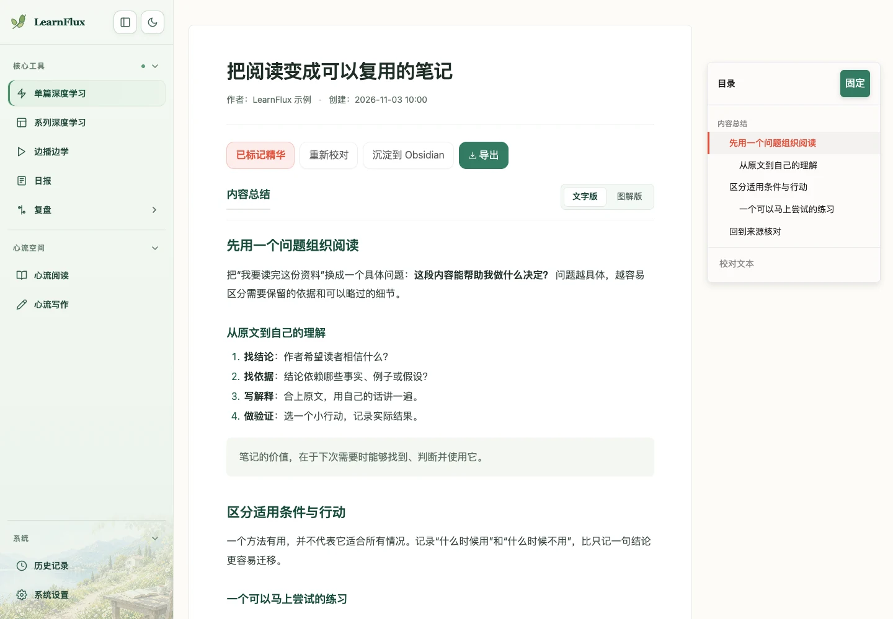
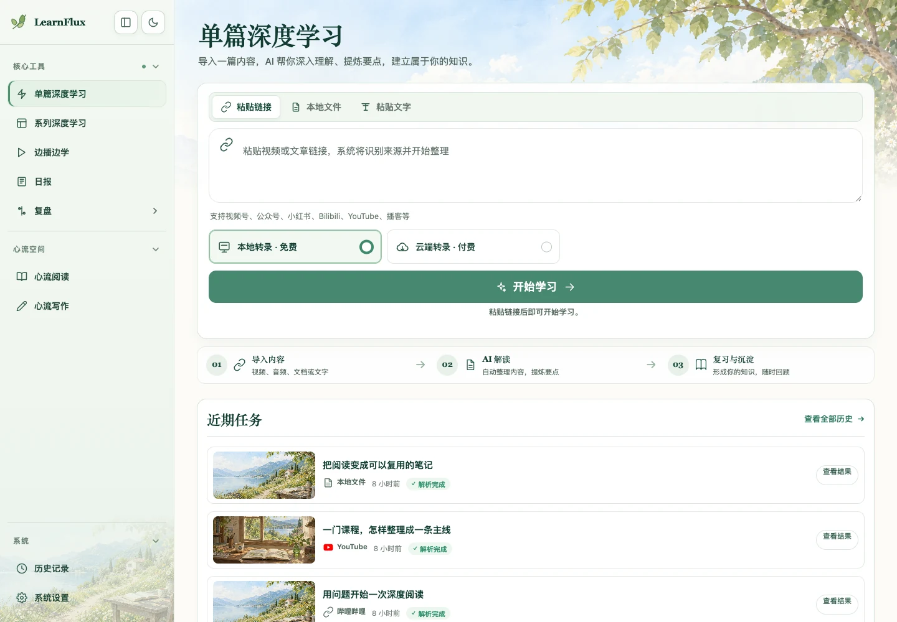
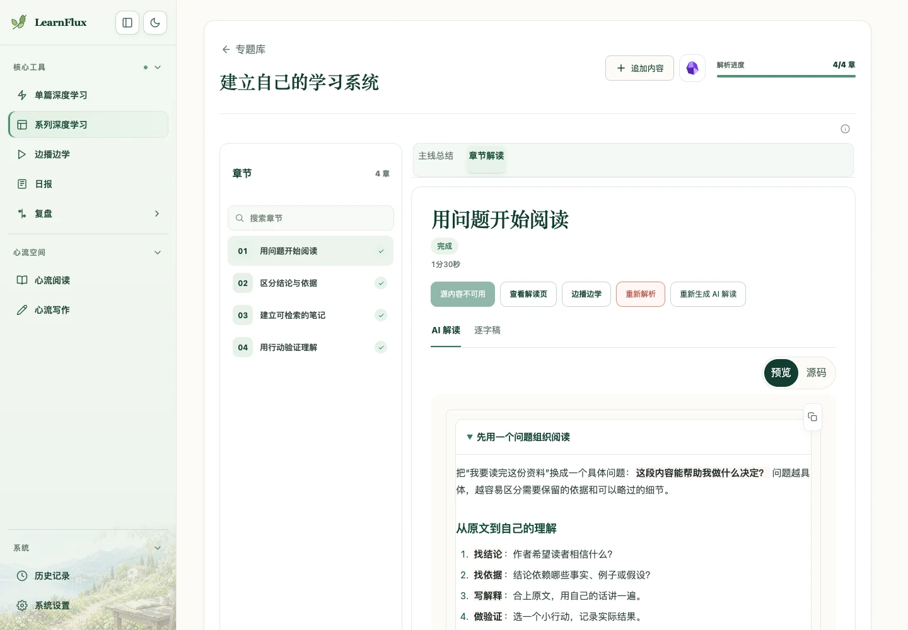
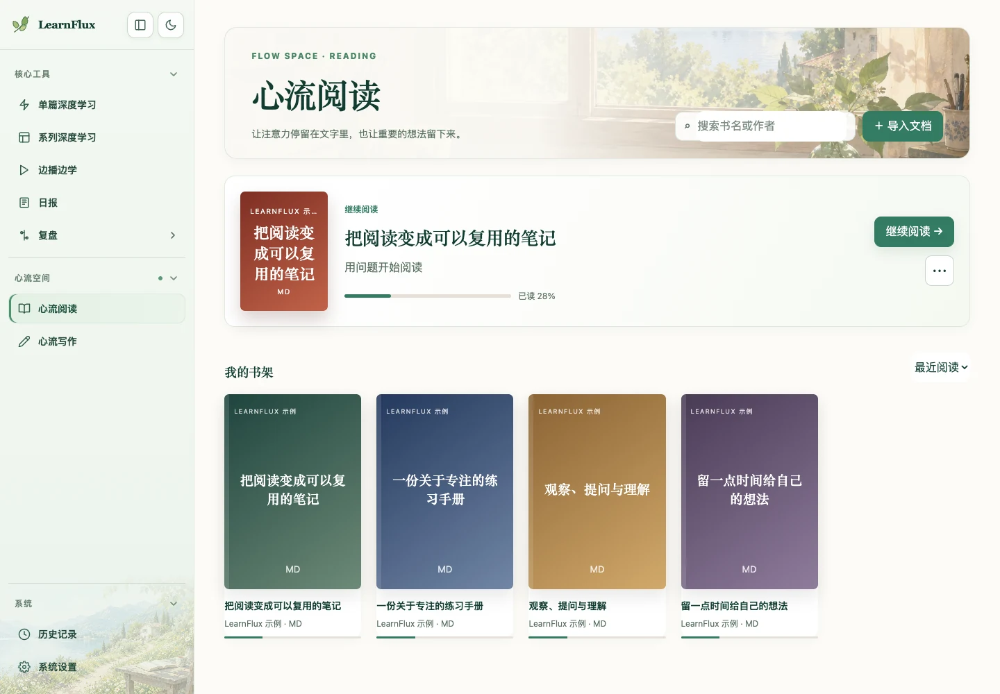
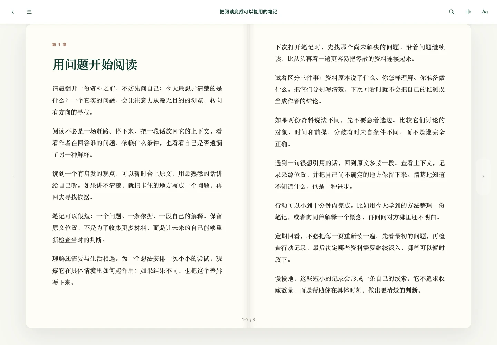
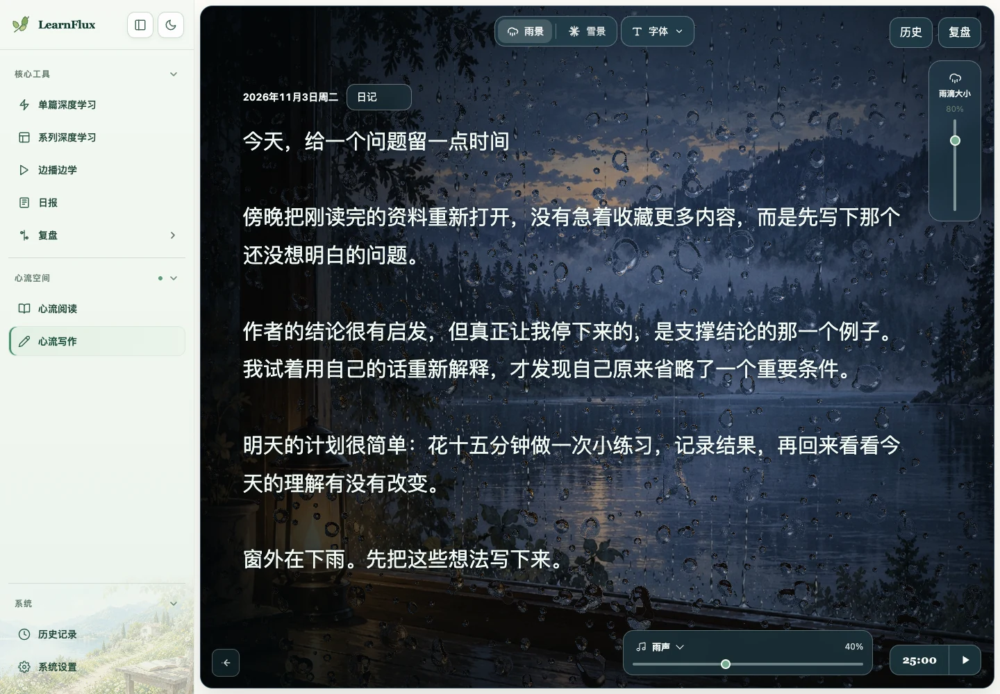
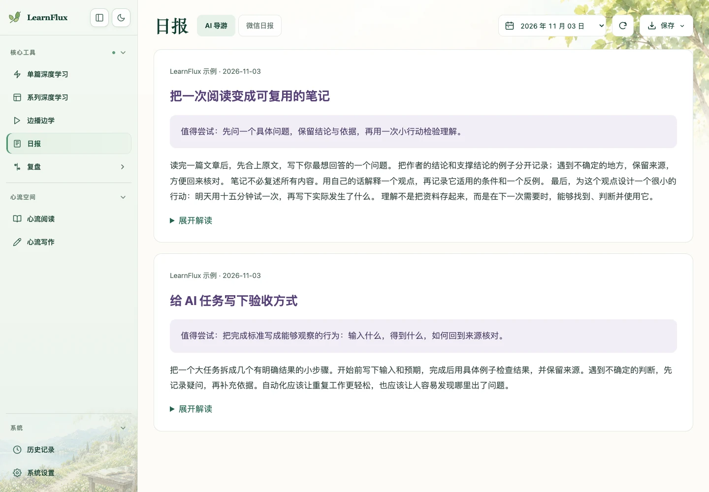

<!-- project-cover:20261101:start -->
<p align="center">
  
</p>
<!-- project-cover:20261101:end -->

# LearnFlux

把视频、文章和文档整理成学习笔记：**读解读、核对原文、接着学，再保存到自己的知识库。**

LearnFlux 是运行在自己电脑或服务器上的 AI 学习工作台。它把单篇资料、系列课程、文档阅读和写作放在同一个地方，适合想认真消化收藏内容、持续整理知识的个人使用。

[快速开始](#快速开始) · [看看能做什么](#看看能做什么) · [使用指南](docs/guides/product-tour.md) · [配置服务](docs/guides/configuration.md) · [文档中心](docs/README.md)

**许可：** [MIT + Commons Clause](LICENSE)，包含商业使用限制；使用前请阅读完整条款。

<p align="center">
  
</p>

所有图片均为当前页面在浏览器中的真实截图，使用原创演示资料。[截图与版本说明](docs/images/readme-20261103/README.md)

## 快速开始

第一次建议先用一小段文字跑通流程。**不需要先安装转录模型、OCR、数据库或知识库集成。**

准备 Git、Bash 和 curl，在 macOS / Linux 终端运行：

```bash
git clone https://github.com/zhangxun-ai/LearnFlux.git
cd LearnFlux
bash scripts/bootstrap.sh
uv run python main.py --start
```

脚本会准备 uv、Python 3.11 和锁定的应用依赖；首次生成独立随机管理口令与仅供本机访问的配置，已有配置和数据保持原样。首次下载依赖可能需要一些时间。

1. 打开 [系统设置](http://127.0.0.1:8000/settings)，填写已有模型服务的 API Key、接口地址和可用模型，保存。
2. 打开 [单篇深度学习](http://127.0.0.1:8000/add_task_by_web)，选择 **粘贴文字**，复制[这段原创示例](examples/first-learning.md)，点击 **开始学习**。
3. 等近期任务完成，打开结果：阅读 AI 解读、核对原文，再导出 Markdown。

AI 调用按你选择的服务商规则计费。普通文档阅读与写作不需要模型 Key；音视频和扫描件按需安装额外组件。前台服务用 `Ctrl+C` 停止。

遇到问题、需要后台运行，或使用 Windows / Docker：[完整首次使用指南](docs/guides/quickstart.md)。也可以复制[安装提示词](docs/prompts/macos-local-quick-start.md)交给能操作本机终端的 Agent。

## 看看能做什么

### 一篇内容，读出自己的理解

粘贴平台链接、选择本地文件，或直接输入文字。后台处理后，在结果页读结构化解读、回看原文、标记精华；要保留时再导出或同步到已配置的知识库。

<p align="center">
  
</p>

### 一门课程，整理成一条主线

把课程或专题资料放进系列，按章节查看处理进度。在 **主线总结** 中理解全貌，在 **章节解读** 中回看某一节；有可播放源文件的章节可以直接进入边播边学。

<p align="center">
  
</p>

### 边播边学，把文稿和视频对上

在播放器里看视频、读分段文稿，点击文稿定位到对应时间；需要时切换 AI 解读、问答和笔记。播放能力取决于源文件是否仍然可用。

<p align="center">
  
</p>

### 在自己的书架里，接着上次读

导入 PDF、EPUB、DOCX、TXT 或 Markdown，按书名或作者查找，继续上次进度。进入阅读器后，可切换单页 / 双页、目录、字号和阅读主题；扫描 PDF 的识别需要可选 OCR 依赖。

<p align="center">
  
</p>

<details>
<summary>打开看看双页阅读器</summary>

<p align="center">
  
</p>

</details>

### 留一点安静的时间，写下自己的想法

在雨景或雪景中写日记、学习笔记或草稿，调整字体、背景音和专注计时。内容自动保存，也可以导出 TXT 或 Markdown。

<p align="center">
  
</p>

### 找回学过的内容，继续往下走

历史记录顶部用绳夹卡片展示最近学习；下方保留可搜索、筛选的记录列表。可以按标题、作者、正文、来源、时间和状态查找，也能选择资料进行带依据的对照提问。

<p align="center">
  
</p>

### 集中阅读已经生成的日报

在 **AI 导游 / 微信日报** 之间切换，按期号日期阅读、下载和按需同步。日报页面只读取已经生成的报告；数据来源、所有者与定时生成需按[日报指南](docs/guides/daily-briefings.md)单独配置。

<p align="center">
  
</p>

复盘模块还支持按日、周、月、年整理记录。各页面的操作步骤、空白状态和前置条件见[使用指南](docs/guides/product-tour.md)。

## 支持的资料与可选服务

| 想处理的内容 | 从哪里开始 | 需要什么 |
| --- | --- | --- |
| 一段自己的文字 | 单篇学习 → 粘贴文字 | AI 解读需要模型服务；不需要 ASR |
| 普通文档、书籍 | 心流阅读 → 导入文档 | 本地解析；扫描件另装 OCR |
| 本地音视频 | 单篇 / 系列 / 边播边学 | FFmpeg 与合适的转录引擎 |
| YouTube、Bilibili、播客等 | 粘贴链接 | 可用字幕优先；无字幕时需要转录 |
| 抖音、小红书等社媒链接 | 粘贴链接 | 通常需要 TikHub；部分来源还受登录、限流或网络影响 |
| 飞书 Wiki / Docx | 粘贴链接 | 本机 CLI 授权及相应文档权限，走文字学习 |
| 手机复制的链接 | iPhone 快捷指令 | 自己的收集入口与在线的本地服务 |
| 保存到 Obsidian / 飞书 | 结果页或独立归档 | 对应知识库路径、账号权限和可选集成配置 |

```bash
# 音视频依赖（再按配置指南选择转录引擎）
bash scripts/bootstrap.sh --with-media

# Apple Silicon Mac 本机 Whisper
bash scripts/bootstrap.sh --with-local-whisper

# 扫描 PDF 的 OCR
uv sync --extra ocr
```

转录引擎可按设备与需求选择本机 Whisper、CapsWriter 或 FunASR，配置方法见指南。安装依赖不等于已启用服务；Whisper / OCR 首次使用还可能下载模型。云端 ASR、TikHub 和 LLM 有各自费用；平台链接能否获取还取决于有效性、权限和来源限制。

[配置与 Key](docs/guides/configuration.md) · [按需配置服务的 Agent 提示词](docs/prompts/optional-services.md) · [手机收集](docs/guides/mobile-shortcut.md) · [飞书归档](docs/guides/feishu-archive.md)

## 常见问题

| 遇到什么 | 先检查什么 |
| --- | --- |
| 页面打不开 | 终端是否仍在运行、实际端口、启动日志；避免重复启动两个实例。 |
| 有原文，没有 AI 解读 | Key、接口地址、模型名是否配套；查看具体任务错误。 |
| 音视频无法转录 | 已选择的转录引擎、模型是否下载、FFmpeg 与源文件是否可用。 |
| 扫描 PDF 等待 OCR | 安装 `ocr` extra 后重启，在书架重试。 |
| 手机显示已执行，电脑没有结果 | 电脑是否在线、收集入口、身份归属；快捷指令执行不等于解析完成。 |
| 旧界面或侧栏不一致 | 正常刷新页面；当前版本共用资源版本和缓存再验证规则。 |

## 开发与更多文档

新安装默认使用 SQLite 与本地文件；PostgreSQL / S3 可选。模型、解析 API 和知识库集成只在启用对应能力时参与处理。不要把真实配置、媒体、密钥或结果访问令牌提交到仓库。

```bash
uv sync --extra dev
uv run --extra dev pytest tests/unit
uv run --extra dev pytest
```

[系统架构](docs/architecture.md) · [API Quick Start](docs/guides/api/quickstart.md) · [测试说明](tests/README.md) · [PostgreSQL 迁移](docs/guides/postgresql.md) · [文档中心](docs/README.md)

Docker 当前按 `linux/amd64` 准备，宿主机默认入口为 `127.0.0.1:8200`；本轮尚未验收镜像构建和容器运行，不作为首次体验的默认路径。[Docker 说明](docs/guides/quickstart.md#docker-替代路径)

当前图文、安装流程与实现代码一同维护；截图使用原创演示资料，实际外部服务验证范围见记录。[验证记录与边界](docs/release-readiness.md)

## 项目来源与许可

LearnFlux 基于 [VideoTranscriptAPI](https://github.com/zlxlabs/VideoTranscriptAPI) 的早期版本持续演进而来。感谢原作者 [@zj1123581321](https://github.com/zj1123581321) 提供的视频解析、转录与 API 基础实现。仓库保留原项目的 Git 历史及版权和许可声明。

项目使用 **MIT License + Commons Clause**。允许个人学习、研究、修改及符合条款的分发；Commons Clause 不授予销售本软件，或以本软件主要功能提供收费服务的权利。完整范围以 [LICENSE](LICENSE) 为准。

开发过程使用 AI Coding Agent 辅助，产品方向、审查、发布与维护由维护者负责。欢迎通过 [Issues](https://github.com/zhangxun-ai/LearnFlux/issues) 反馈问题或提交 Pull Request；请去除密钥、真实结果令牌和私有内容。
