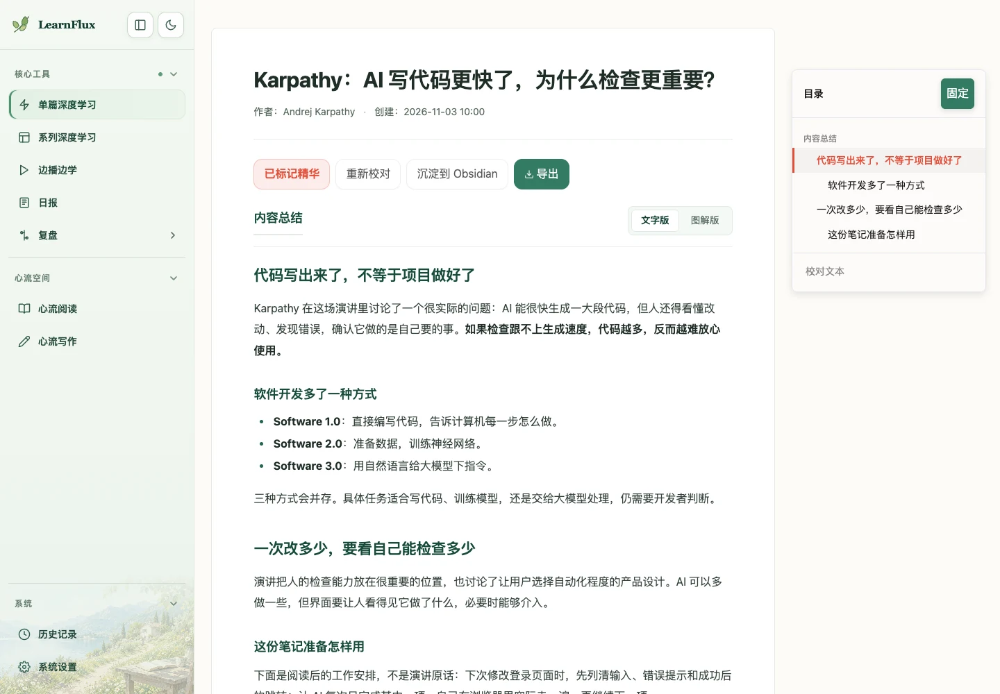
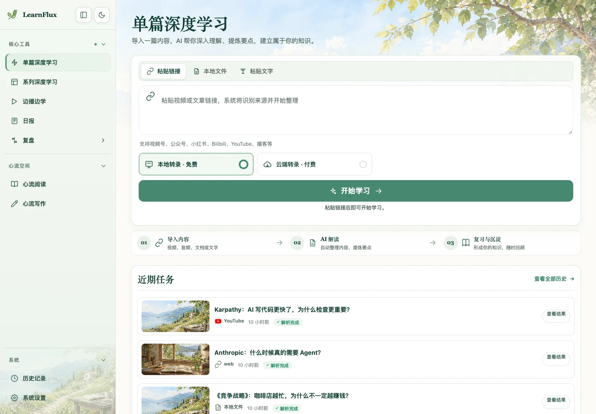
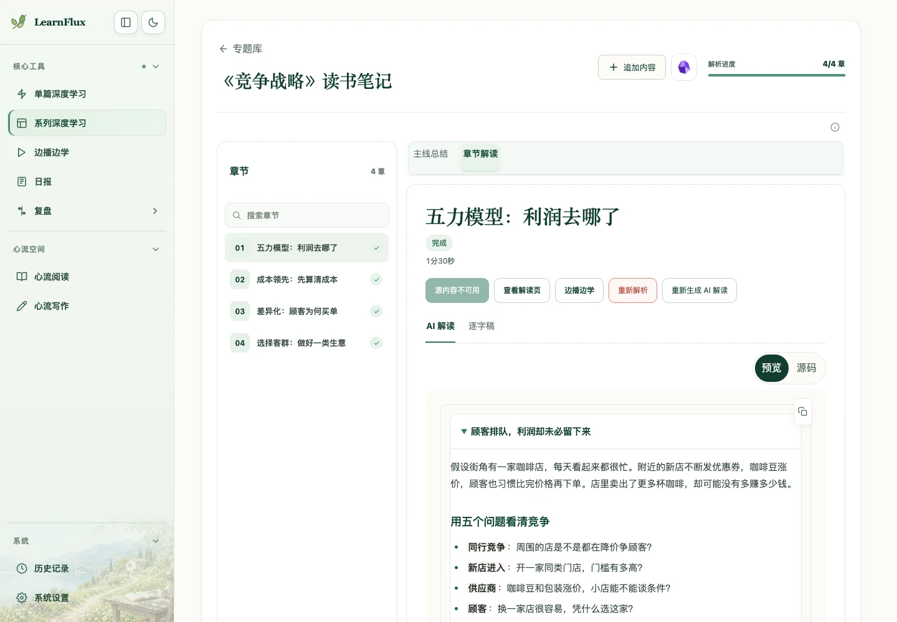
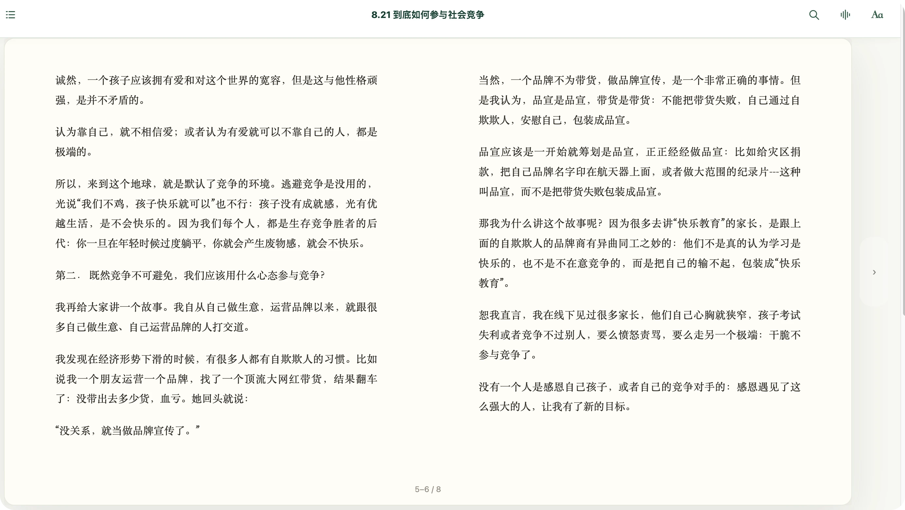
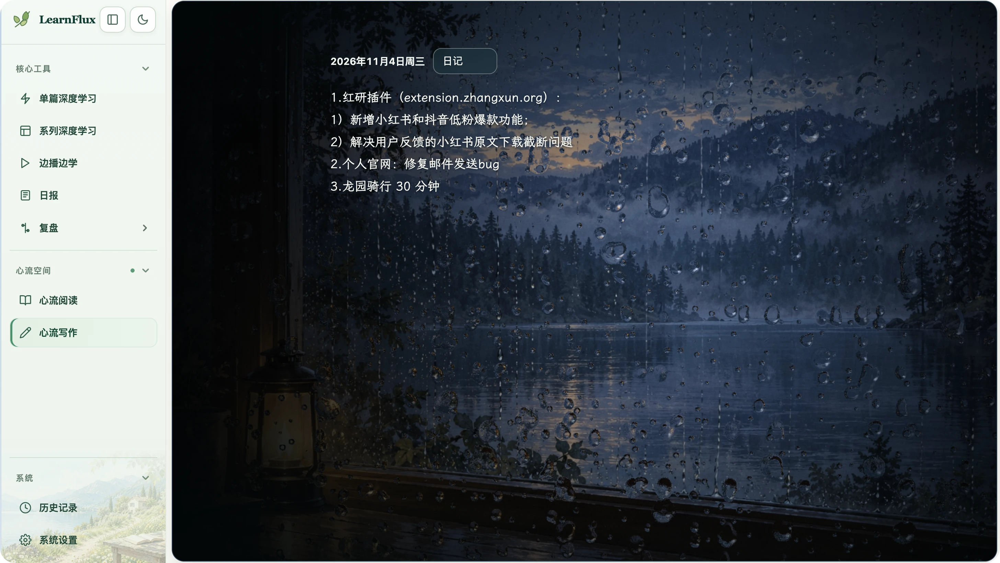
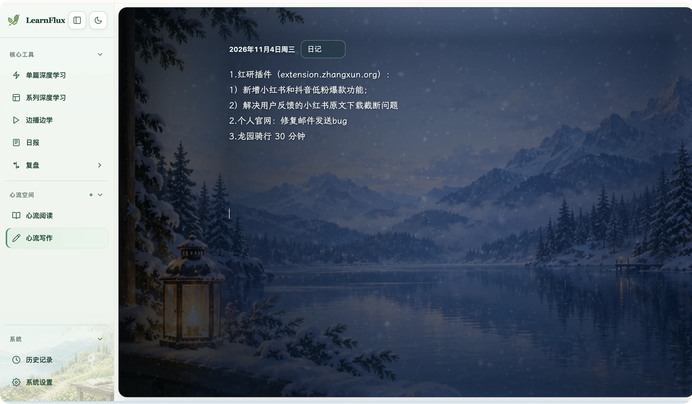

<!-- project-cover:20261103:start -->
<p align="center">
  
</p>
<!-- project-cover:20261103:end -->

# LearnFlux

**把看到的好内容，变成随时能读、能回看的学习笔记。**

LearnFlux 是运行在自己电脑或服务器上的 AI 学习工作台。导入支持的视频链接、文章来源或本地文档，配置对应服务后可以获得原文和 AI 解读；继续提问、记笔记，再导出或保存到 Obsidian、飞书。课程学习、电子书阅读和日常写作也可以在这里完成。

[复制安装提示词](#不懂代码复制这段提示词给-ai) · [看实际页面](#功能介绍) · [启动项目 / 首次安装](#快速开始) · [使用指南](docs/guides/product-tour.md) · [文档中心](docs/README.md)

日常启动：在项目根目录运行 **`bash server.sh start`**，默认访问 **[http://127.0.0.1:8000](http://127.0.0.1:8000)**。首次使用请先完成[安装和配置](#快速开始)。

许可：[MIT + Commons Clause](LICENSE)，包含商业使用限制。

## 一张图，看懂能做什么

<p align="center">
  
</p>

比如，在小红书看到值得学习的视频：**复制链接 → 轻点手机背部 3 下 → 工作台解析并生成解读 → 自动归档飞书 → 在手机飞书阅读。** 图示以已配置并验证可用的本地转录为例，收集和阅读可以在手机上完成；若视频需要云端 ASR，还须到工作台确认该任务的报价，之后才会继续识别。

这条闭环需要先绑定 iPhone 快捷指令、配置平台解析与转录、启用飞书归档；处理时电脑需保持运行、联网且不休眠。快捷指令的“已执行”提示只表示已运行，结果以后台任务和飞书文档为准。已归档的飞书文档可以在电脑离线后继续阅读。[手机收集设置](docs/guides/mobile-shortcut.md) · [飞书归档设置](docs/guides/feishu-archive.md)

其他模块也能单独使用；外部归档和日报来源按需配置。先跑通一条真实链接，再添加你需要的功能。

## 不懂代码？复制这段提示词给 AI

**推荐新手从这里开始：** 点击下面代码框右上角的复制按钮，把整段发给 WorkBuddy、Codex、Claude Code 等能操作本机终端和浏览器的 Agent。它会根据你的电脑和目标引导安装；需要登录、输入 Key 或确认费用时，你再在本机操作。

```text
我是第一次使用 LearnFlux，不懂代码。请操作我的电脑，一步步带我安装并跑通真实链接。
项目：https://github.com/zhangxun-ai/LearnFlux
没有仓库时先克隆；已有仓库、配置和资料请保留。先读 README 和 docs/prompts/macos-local-quick-start.md，再按完整提示词执行，不只给命令就结束。
先确认我要用的平台（YouTube / 抖音 / 小红书等）、真实短链接、转录方式与费用范围。引导我在本机填写模型 Key；抖音/小红书按需准备 TikHub；需要语音识别时安装并验证本地 ASR，或配置云端 ASR 并由我确认报价。不同服务的 Key 不能混用。
新安装默认 SQLite 自动建表；已有 PostgreSQL 保留，新增 PostgreSQL 按指南建库并检查自动迁移。首次安装用 scripts/bootstrap.sh 准备环境；日常启动执行 bash server.sh start，默认端口 8000。
最终逐个平台验收：真实内容取得 → 正文、字幕或实际 ASR → 真实 AI 解读 → 查看与导出 → 历史保存。示例文字、缓存和模拟返回不能代替新视频转录验收。
如果我还选择手机到飞书闭环，再按手机收集和飞书归档指南配置并实测，不默认开放公网。真实 Key 和私密结果令牌不进入聊天、截图、日志或 Git；付费调用先取得授权。
遇到缺凭据或不兼容时告诉我在哪里操作、应看到什么；能继续的工作继续做，未通过的环节如实说明。
```

<details>
<summary>展开复制完整安装与真实链接验收提示词（含 Key、ASR、数据库和排错要求）</summary>

```text
我是第一次使用 LearnFlux，不懂 Git、终端和数据库。请直接操作我的电脑，完成真实链接的安装与验收；需要我输入凭据、登录或确认费用时，用中文引导我在本机操作，不要只给命令后结束。

项目：https://github.com/zhangxun-ai/LearnFlux
目标：真实链接 → 解析/下载 → 字幕、正文或实际ASR → AI校对解读 → 查看/导出 → 历史持久保存。示例文字和mock不作为最终成功证据。

1. 先确认我要用的平台（YouTube / 抖音 / 小红书，可多选）、本地或云端转录、愿意处理的短样例链接与费用范围。我不了解时结合电脑推荐。选中多个平台就分别验收；没样例时帮我选公开、可访问的短内容，不编造链接。
2. 阅读 README、AGENTS.md、.env.example 和完整提示词 docs/prompts/macos-local-quick-start.md。检查系统、CPU、网络、依赖与8000端口，复用已有仓库和服务；没有仓库再克隆。已有配置、数据库和资料不得覆盖。
3. 仅在.env不存在时执行 cp -n .env.example .env，并设置 chmod 600 .env；先确认私密文件被Git忽略。新安装默认SQLite自动建表，已有PostgreSQL保留原连接；选择新装PostgreSQL时按数据库指南建账号/库并核对自动SQL迁移，不清库。
4. 仅在首次安装或确实缺少依赖时使用 scripts/bootstrap.sh；需要音视频时执行 bash scripts/bootstrap.sh --with-media 并检查FFmpeg/ffprobe。该脚本准备环境，不启动服务；缺FFmpeg时macOS需先有Homebrew，Ubuntu/Debian需apt-get及安装权限。引导我在本机.env填写DeepSeek或已有兼容服务的 LEARNFLUX_LLM_API_KEY、LEARNFLUX_LLM_BASE_URL、LEARNFLUX_LLM_MODEL，核对当前可用模型与llm.model_endpoints路由；模板qwen*默认走百炼次级端点，不能只配主Key就声称可用。官方SDK示例的DEEPSEEK_API_KEY不是项目读取名。
5. 我要用抖音/小红书时，再引导我在TikHub用户中心取得自己的Key，填 LEARNFLUX_TIKHUB_API_KEY，按需设置 LEARNFLUX_TIKHUB_BASE_URL。TikHub取内容、DeepSeek做解读、ASR识别语音，三者凭据不能混用；YouTube字幕路径通常不要求TikHub。真实Key不发到聊天、不写源码或模板。
6. 本地ASR：当前普通链接local策略走MLX Whisper。Apple Silicon Mac用 bash scripts/bootstrap.sh --with-local-whisper，按输出设置私有local_whisper配置，确认程序与模型可用；Intel Mac/Linux/Windows不能照搬，也不能只填CapsWriter地址就声称local可用。需要本地但当前不支持时说明缺口，不擅自切云端收费。
7. 云端ASR：引导我在本机.env填写百炼 DASHSCOPE_API_KEY、DASHSCOPE_WORKSPACE_ID、DASHSCOPE_API_HOST，核对同一Workspace北京节点，在私有主配置启用cloud_asr.enabled，选择cloud；音频准备后的实际报价须由我确认费用上限再提交。DeepSeek/TikHub Key不能替代ASR凭据，不盲目重发未知状态的云任务。
8. 用 bash server.sh start 启动，默认 http://127.0.0.1:8000；status / log检查，配置变化后restart，stop停止。不要重复启动或结束其他程序；macOS登录启动项由stop卸载。真实调用前说明哪些服务会收到内容、可能的费用并取得授权；已同意范围内继续，不自动购买或充值。
9. 在单篇深度学习粘贴我选择的真实链接并提交，等待成功。核对来源、原文覆盖、真实AI解读和完整导出，刷新后从历史记录重新打开；新建且可安全停止的实例再重启验证保存。平台字幕、图文和缓存都不证明ASR成功；要验ASR，另用未缓存、需要识别语音的口播短视频，小红书选视频笔记，不能用抖音图集替代。
10. 失败时区分平台/权限/TikHub、下载/FFmpeg、ASR和模型问题，在授权预算内修复并继续；示例文字仅辅助排错，最终必须回到真实链接。缺Key、授权或兼容条件时引导我补齐，并把对应真实链路标为未完成，不把页面打开、任务受理、缓存或mock说成全部通过。
11. 最后按平台和实际内容路径列出解析/下载、字幕或ASR、AI解读、查看/导出、持久化的通过/失败/未验证结果，给本机入口和导出位置，不公开私密结果令牌。选中的平台和ASR模式实际跑通才说可用；不默认配置无关OCR、飞书、公网或生图，不替我提交或推送代码。
```

</details>

也可以打开[独立完整版提示词](docs/prompts/macos-local-quick-start.md)复制。真实 Key 只在自己的电脑填写。

基础链路跑通后，想启用上图的手机到飞书闭环，可继续复制[手机收集与飞书归档提示词](docs/prompts/optional-services.md)，分别验证手机提交、后台处理和飞书全文阅读。

## 功能介绍

先看学习结果和日常回看，再按需展开阅读、写作与日报。[截图来源说明](docs/images/readme-20261103-real/README.md) · [新版雨雪写作截图](docs/images/readme-20261104-real/README.md)。

### 单篇深度学习：提炼视频、文章和文档要点

粘贴支持的链接、上传文件或输入文字。音视频在转录服务可用时生成逐字稿；飞书文档、小红书图文等支持来源提取正文，再由配置好的模型总结要点。普通网页链接不保证能够自动提取文章，遇到不支持的来源可粘贴正文。阅读时可以回看原文、标记重要内容，也可以导出笔记，或保存到已配置的 Obsidian、飞书。

<p align="center">
  
</p>

<details>
<summary>查看导入页面</summary>

<p align="center">
  
</p>

</details>

### 系列深度学习：按章节学习，生成课程总结

上传或从本机路径导入一门课程、同一主题的文档资料，逐章查看原文和 AI 解读，再生成全系列总结。系列按音视频课程、文档专题区分资料类型；目前不是批量粘贴网页链接导入。有可播放源文件的章节，可以直接进入 **边播边学**。

<p align="center">
  
</p>

### 边播边学：对照文稿看视频，随手记笔记

视频和逐字稿并排显示，点击文段可以定位播放位置：有时间戳时按时间定位，没有时间戳时按文段长度估算，可能与语音有偏差。遇到不懂的内容可以向 AI 提问，也可以边看边记笔记。播放需要保留可用的源文件。

<p align="center">
  
</p>

### 历史记录：搜索和回看学过的内容

按标题、作者或正文搜索，也可以按来源、时间和处理状态筛选，重新打开原文和 AI 总结。选中多份资料后，可以向 AI 提问、比较其中的观点，回答会附上引用出处。

<p align="center">
  
</p>

<details>
<summary>查看按平台筛选记录</summary>

<p align="center">
  
</p>

</details>

<details>
<summary>心流阅读：沉浸式阅读 PDF、电子书和文档（展开查看真实页面与操作）</summary>

支持 PDF、EPUB、DOCX、TXT 和 Markdown，导入后统一放在书架中。阅读器支持单页 / 双页、目录、字号和主题切换，并自动保存阅读进度。扫描版 PDF 需要另外安装 OCR（文字识别工具）。

<p align="center">
  
</p>

<details>
<summary>查看双页阅读界面</summary>

<p align="center">
  
</p>

</details>

</details>

<details>
<summary>心流写作：在雨雪场景中专注写作（展开查看真实页面与操作）</summary>

用来写日记、学习笔记或草稿。可以选择雨景或雪景，调整字体与背景音，使用专注计时。草稿自动保存在当前浏览器，不会因此写入服务器数据库或跨浏览器同步；重要内容请导出 TXT 或 Markdown 保存，清除浏览器数据可能丢失草稿。

<p align="center">
  
</p>

<details>
<summary>查看雪景写作界面</summary>

<p align="center">
  
</p>

</details>

</details>

<details>
<summary>日报：集中阅读 AI 资讯和微信日报（展开查看真实页面与操作）</summary>

在同一个页面阅读 **AI 导游** 和 **微信日报**，按日期查看往期内容，下载或保存报告。使用前需按[日报指南](docs/guides/daily-briefings.md)配置数据来源、报告生成和所属账号；当前仅向指定账号开放本机直连阅读，不能据此认为公网域名也可访问。打开页面本身不会生成日报。

<p align="center">
  
</p>

复盘模块支持按日、周、月、年记录和回顾。详细操作步骤见[使用指南](docs/guides/product-tour.md)。

</details>

## 快速开始

**启动项目使用根目录的 `server.sh`。** 已安装依赖并完成配置后，在项目根目录运行：

```bash
bash server.sh start
```

默认打开 **[http://127.0.0.1:8000](http://127.0.0.1:8000)**，以实际监听配置为准。看到工作台页面后，再提交学习任务。启动成功不代表模型、平台解析或 ASR 已配置完成。

日常管理同样使用这个脚本：

```bash
bash server.sh status   # 查看端口监听与后台状态
bash server.sh log      # 查看实时日志，Ctrl+C 退出日志查看
bash server.sh restart  # 修改配置后重启，会中断当前进程
bash server.sh stop     # 停止服务
```

第一次下载项目时，需要先安装依赖和填写配置，再使用上面的启动命令。可以复制上方[安装提示词](#不懂代码复制这段提示词给-ai)交给 Agent，或展开以下手动步骤。

<details>
<summary>首次安装：下载项目、准备环境与配置服务（完成后再用 server.sh 启动）</summary>

以下从全新目录开始，仅适用于首次安装。已有项目先检查缺少项，保留当前配置、数据库和资料，不要照抄模板切换数据库。

需要 Git、Bash、curl、lsof 和能下载依赖的网络。`--with-media` 会检查 FFmpeg；若尚未安装，macOS 需先有 Homebrew，Ubuntu / Debian 需有 `apt-get` 和安装权限，其他 Linux 发行版需自行安装 FFmpeg。确认后在终端运行：

```bash
git clone https://github.com/zhangxun-ai/LearnFlux.git
cd LearnFlux
cp -n .env.example .env
chmod 600 .env
bash scripts/bootstrap.sh --with-media
```

`scripts/bootstrap.sh --with-media` 只准备环境：安装或复用 uv，由 uv 选择 / 下载 Python 3.11、安装应用依赖，在主配置不存在时生成本机配置和随机管理口令，再检查 / 安装 FFmpeg。它不会启动工作台，也不会安装 ASR 引擎或替你配置外部服务。

已有主配置不会被覆盖；若仅有旧 `config/config.json`，脚本会提示先迁移，不会自动转换。首次下载可能较慢；日常启动直接使用 `bash server.sh start`。只做文字学习时，可用不带 `--with-media` 的 `bash scripts/bootstrap.sh` 准备基础环境。

**全新安装使用模板默认的 SQLite，首次启动自动建表，无需另装数据库服务。** 已有 PostgreSQL 用户保留原连接；新装 PostgreSQL 请先按[数据库指南](docs/guides/postgresql.md)创建专用账号和数据库，再设置 `LEARNFLUX_PERSISTENCE_BACKEND=postgres` 与 `DATABASE_URL`。启用 PostgreSQL 后，启动会自动应用待执行的版本化 SQL 建表或更新结构；这不等于自动搬迁 SQLite 旧资料。

**配置本次需要的服务**

在自己的 `.env` 中填写真实值；[.env.example](.env.example) 是公开模板。非空环境变量优先于设置页，修改后需要重启。已有用户可保留原有私有配置。**真实 `.env`、私有配置、Cookie 和数据库不要上传到 GitHub，也不要把 Key 发到聊天里。**

| 你要使用什么 | 需要准备什么 |
| --- | --- |
| AI 校对、总结与问答 | DeepSeek 或兼容模型服务：`LEARNFLUX_LLM_API_KEY`、`LEARNFLUX_LLM_BASE_URL`、`LEARNFLUX_LLM_MODEL` |
| 抖音 / 小红书链接 | `LEARNFLUX_TIKHUB_API_KEY`；视频还需要可用的转录方式 |
| 本地语音转录 | FFmpeg、本地引擎与模型；当前普通链接的 `local` 策略使用 Apple Silicon Mac 的 MLX Whisper |
| 云端语音转录 | 百炼的三项 `DASHSCOPE_*` 凭据、启用 `cloud_asr.enabled`，提交时选择 `cloud` 并确认报价 |
| YouTube 可用字幕 / 小红书图文 | 可取得的字幕或正文、模型服务；小红书仍按来源配置 TikHub，此路径可能不运行 ASR |

复用其他模型服务时，还要核对私有配置的 `llm.model_endpoints`：模板中的 `qwen*` 会路由到百炼次级端点，不能只改主模型的三项环境变量就认为已配好。详见[模型配置](docs/guides/configuration.md)。

Apple Silicon Mac 可用 `bash scripts/bootstrap.sh --with-local-whisper` 安装本地引擎，并按输出完成配置。Intel Mac、Linux、Windows 不能照搬这条本地路径，需选择当前支持的云端方案或核对兼容性。Key 获取入口、具体字段与排错见[服务配置指南](docs/guides/configuration.md)。

模型、TikHub、云端 ASR 各自计费，也分别接收相应的正文、链接或媒体；先确认内容与费用范围。本地转录不收云端 ASR 费用，模型和 TikHub 仍可能收费。

准备完成后，在项目根目录执行 `bash server.sh start`；以后启动继续用同一条命令，无需重复安装。

</details>

### 跑通一条真实链接

1. 打开[系统设置](http://127.0.0.1:8000/settings)，核对模型和所选服务是否生效；修改 `.env` 后先检查当前任务，再重启服务。
2. 打开[单篇深度学习](http://127.0.0.1:8000/add_task_by_web)，粘贴你有权处理的真实链接，选择已配置的转录方式并提交；云端按页面报价确认费用。
3. 等待完成，核对来源、原文与 AI 解读；导出并打开文件，再从历史记录重新打开结果。每个要使用的平台都分别跑一条。要验证 ASR，须用未缓存、需要语音识别的真实视频；字幕、图文和示例文字只验证各自的处理路径。

<details>
<summary>后台运行、端口、前台排错与已验证范围</summary>

macOS 使用用户级 LaunchAgent 后台运行，并在用户登录时自动启动；`stop` 会卸载该启动项。Linux 使用 nohup 后台运行，不自动配置开机启动。电脑休眠、关机或断网会影响任务处理。

端口优先读取非空的 `LEARNFLUX_API_PORT`，未设置时沿用私有 `config/config.jsonc` 的 `api.port`，默认 8000。若更改端口或监听地址，请使用对应的访问地址；本机 `127.0.0.1` 地址不能直接供手机访问。`status` 主要检查端口监听，任务和页面是否可用仍须实际检查。

前台排错时先确认当前没有需要保留运行的任务，再执行 `bash server.sh stop` 和 `uv run python main.py --start`；此时 `Ctrl+C` 会停止前台服务。不要同时启动两个实例。

SQLite 已通过隔离的文字学习、导出、笔记、合集、阅读与重启持久化检查；该检查使用模拟模型结果，不能代替真实模型、音视频平台或 OCR 验收。已有 PostgreSQL 不会自动迁移到 SQLite；现有用户更新配置时应保留原后端和连接。

</details>

Windows、Docker、详细排错见[完整首次使用指南](docs/guides/quickstart.md)。

## 支持哪些内容，需要哪些服务

| 想处理的内容 | 从哪里开始 | 需要什么 |
| --- | --- | --- |
| 一段自己的文字 | 单篇学习 → 粘贴文字 | AI 解读需要模型服务；不需要语音转录 |
| 普通文档、书籍 | 心流阅读 → 导入文档 | 本地解析；扫描件另装 OCR |
| 本地音视频 | 单篇 / 系列 / 边播边学 | FFmpeg 与合适的转录引擎 |
| YouTube | 粘贴链接 | 可用字幕优先；无字幕时需要 FFmpeg 与转录引擎 |
| Bilibili、播客音频等 | 粘贴链接 | 下载音视频后转录，需要 FFmpeg 与转录引擎 |
| 抖音、小红书等社媒链接 | 粘贴链接 | 通常需要 TikHub；部分来源还受登录、限流或网络影响 |
| 飞书 Wiki / Docx | 粘贴链接 | 启用 `feishu_documents`、匹配所属账号、已登录的飞书命令行工具及读取权限，见[飞书文档指南](docs/guides/feishu-documents.md) |
| 手机复制的链接 | iPhone 快捷指令 | 已配置快捷指令，运行服务的电脑保持在线 |
| 保存到 Obsidian / 飞书 | 结果页或独立归档 | 对应知识库路径、账号权限和可选集成配置 |

```bash
# 音视频依赖（再按配置指南选择转录引擎）
bash scripts/bootstrap.sh --with-media

# Apple Silicon Mac 本机 Whisper
bash scripts/bootstrap.sh --with-local-whisper

# 扫描 PDF 的 OCR
uv sync --extra ocr
```

普通链接的 `local` 策略使用本机 MLX Whisper；CapsWriter 供其他兼容调用路径使用，不能代替这条策略的安装验证。需要区分说话人时再核对独立 FunASR 路径。安装后还需按[配置指南](docs/guides/configuration.md)启用。Whisper / OCR 首次使用可能需要下载模型。云端转录、TikHub 和 AI 模型分别由各服务商计费；部分平台还需要登录，并可能受访问频率或网络限制影响。

[配置与 Key](docs/guides/configuration.md) · [按需配置服务的 Agent 提示词](docs/prompts/optional-services.md) · [手机收集](docs/guides/mobile-shortcut.md) · [飞书归档](docs/guides/feishu-archive.md)

## 常见问题

| 遇到什么 | 先检查什么 |
| --- | --- |
| 页面打不开 | 运行 `bash server.sh status` 和 `bash server.sh log`，确认服务状态、实际端口与启动日志；避免重复启动两个实例。 |
| 有原文，没有 AI 解读 | Key、接口地址、模型名是否配套；查看具体任务错误。 |
| 音视频无法转录 | 已选择的转录引擎、模型是否下载、FFmpeg 与源文件是否可用。 |
| 扫描 PDF 等待 OCR | 安装 `ocr` extra 后重启，在书架重试。 |
| 手机显示已执行，电脑没有结果 | 电脑上的服务是否在运行、快捷指令中的地址和口令是否正确，再查看任务状态。 |

## 开发与更多文档

[系统架构](docs/architecture.md) · [API Quick Start](docs/guides/api/quickstart.md) · [测试说明](tests/README.md) · [PostgreSQL](docs/guides/postgresql.md) · [本地验证范围](docs/release-readiness.md) · [文档中心](docs/README.md)

<details>
<summary>开发检查与其他部署方式</summary>

```bash
uv sync --extra dev
uv run --extra dev pytest tests/unit
uv run --extra dev pytest
```

新安装默认 SQLite 和本地文件，PostgreSQL / S3 可选。不要将真实配置、媒体、密钥或结果访问令牌加入仓库。

Docker 当前按 `linux/amd64` 准备，宿主机默认入口为 `127.0.0.1:8200`；镜像构建和容器运行尚未验收。[Docker 说明](docs/guides/quickstart.md#docker-替代路径)

</details>

## 项目来源与许可

LearnFlux 基于 [VideoTranscriptAPI](https://github.com/zlxlabs/VideoTranscriptAPI) 的早期版本持续演进而来。感谢原作者 [@zj1123581321](https://github.com/zj1123581321) 提供的视频解析、转录与 API 基础实现。仓库保留原项目的 Git 历史及版权和许可声明。

项目使用 **MIT License + Commons Clause**。允许个人学习、研究、修改及符合条款的分发；Commons Clause 不授予销售本软件，或以本软件主要功能提供收费服务的权利。完整范围以 [LICENSE](LICENSE) 为准。

开发过程使用 AI Coding Agent 辅助，产品方向、审查、发布与维护由维护者负责。欢迎通过 [Issues](https://github.com/zhangxun-ai/LearnFlux/issues) 反馈问题或提交 Pull Request；请去除密钥、真实结果令牌和私有内容。
