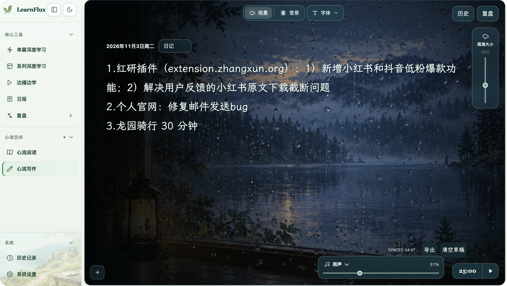
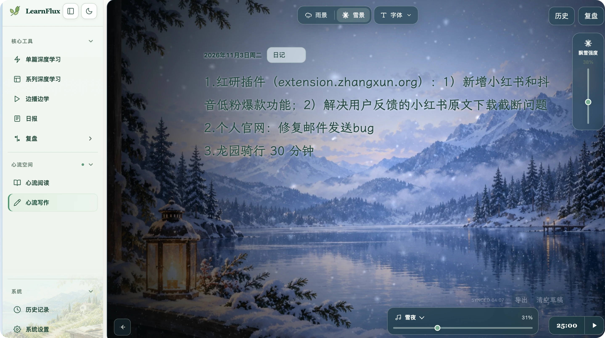

<!-- project-cover:20261103:start -->
<p align="center">
  
</p>
<!-- project-cover:20261103:end -->

# LearnFlux

**用 AI 提炼视频、文章和文档的要点，整理学习笔记。**

LearnFlux 是一个可以部署在自己电脑或服务器上的 AI 学习工具。导入资料后，可以阅读原文和 AI 总结、围绕内容提问、记录笔记，再导出或保存到 Obsidian、飞书。也可以用它管理课程、阅读电子书和写日记。

[复制新手提示词](#不懂代码复制这段提示词给-ai) · [快速开始](#快速开始) · [功能介绍](#功能介绍) · [使用指南](docs/guides/product-tour.md) · [配置服务](docs/guides/configuration.md) · [文档中心](docs/README.md)

**许可：** [MIT + Commons Clause](LICENSE)，包含商业使用限制；使用前请阅读完整条款。

以下包含本地实际使用截图和公开资料演示，展示真实页面与操作。[截图说明](docs/images/readme-20261103-real/README.md)

## 不懂代码？复制这段提示词给 AI

把下面整段发给 WorkBuddy、Codex、Claude Code 等能操作本机终端和浏览器的 Agent。验收目标是你要用的平台真实链接能够解析、解读和导出；示例文字只用于排错。真实 Key 和密码只在自己的电脑填写，不要附在聊天里。

```text
我是第一次使用 LearnFlux，不懂 Git、终端和数据库。请直接操作我的电脑，完成真实链接的安装与验收；需要我输入凭据、登录或确认费用时，用中文引导我在本机操作，不要只给命令后结束。

项目：https://github.com/zhangxun-ai/LearnFlux
目标：真实链接 → 解析/下载 → 字幕、正文或实际ASR → AI校对解读 → 查看/导出 → 历史持久保存。示例文字和mock不作为最终成功证据。

1. 先确认我要用的平台（YouTube / 抖音 / 小红书，可多选）、本地或云端转录、愿意处理的短样例链接与费用范围。我不了解时结合电脑推荐。选中多个平台就分别验收；没样例时帮我选公开、可访问的短内容，不编造链接。
2. 阅读 README、AGENTS.md、.env.example 和完整提示词 docs/prompts/macos-local-quick-start.md。检查系统、CPU、网络、依赖与8000端口，复用已有仓库和服务；没有仓库再克隆。已有配置、数据库和资料不得覆盖。
3. 仅在.env不存在时执行 cp -n .env.example .env，并设置 chmod 600 .env；先确认私密文件被Git忽略。新安装默认SQLite自动建表，已有PostgreSQL保留原连接；选择新装PostgreSQL时按数据库指南建账号/库并核对自动SQL迁移，不清库。
4. 安装基础依赖；需要音视频时执行 bash scripts/bootstrap.sh --with-media 并检查FFmpeg。引导我在本机.env填写DeepSeek或已有兼容服务的 LEARNFLUX_LLM_API_KEY、LEARNFLUX_LLM_BASE_URL、LEARNFLUX_LLM_MODEL，核对当前可用模型；官方SDK示例的DEEPSEEK_API_KEY不是项目读取名。
5. 我要用抖音/小红书时，再引导我在TikHub用户中心取得自己的Key，填 LEARNFLUX_TIKHUB_API_KEY，按需设置 LEARNFLUX_TIKHUB_BASE_URL。TikHub取内容、DeepSeek做解读、ASR识别语音，三者凭据不能混用；YouTube字幕路径通常不要求TikHub。真实Key不发到聊天、不写源码或模板。
6. 本地ASR：当前普通链接local策略走MLX Whisper。Apple Silicon Mac用 bash scripts/bootstrap.sh --with-local-whisper，按输出设置私有local_whisper配置，确认程序与模型可用；Intel Mac/Linux/Windows不能照搬，也不能只填CapsWriter地址就声称local可用。需要本地但当前不支持时说明缺口，不擅自切云端收费。
7. 云端ASR：引导我在本机.env填写百炼 DASHSCOPE_API_KEY、DASHSCOPE_WORKSPACE_ID、DASHSCOPE_API_HOST，核对同一Workspace北京节点，在私有主配置启用cloud_asr.enabled，选择cloud；音频准备后的实际报价须由我确认费用上限再提交。DeepSeek/TikHub Key不能替代ASR凭据，不盲目重发未知状态的云任务。
8. 用 bash server.sh start 启动，默认 http://127.0.0.1:8000；status / log检查，配置变化后restart，stop停止。不要重复启动或结束其他程序；macOS登录启动项由stop卸载。真实调用前说明哪些服务会收到内容、可能的费用并取得授权；已同意范围内继续，不自动购买或充值。
9. 在单篇深度学习粘贴我选择的真实链接并提交，等待成功。核对来源、原文覆盖、真实AI解读和完整导出，刷新后从历史记录重新打开；新建且可安全停止的实例再重启验证保存。平台字幕、图文和缓存都不证明ASR成功；要验ASR，另用未缓存、需要识别语音的口播短视频，小红书选视频笔记，不能用抖音图集替代。
10. 失败时区分平台/权限/TikHub、下载/FFmpeg、ASR和模型问题，在授权预算内修复并继续；示例文字仅辅助排错，最终必须回到真实链接。缺Key、授权或兼容条件时引导我补齐，并把对应真实链路标为未完成，不把页面打开、任务受理、缓存或mock说成全部通过。
11. 最后按平台和实际内容路径列出解析/下载、字幕或ASR、AI解读、查看/导出、持久化的通过/失败/未验证结果，给本机入口和导出位置，不公开私密结果令牌。选中的平台和ASR模式实际跑通才说可用；不默认配置无关OCR、飞书、公网或生图，不替我提交或推送代码。
```

[完整安装与真实链接验收提示词](docs/prompts/macos-local-quick-start.md)包含更细的配置、排错和费用边界。下面是手动安装方式。

## 快速开始

**以一条你实际要处理的真实链接完成首次验收。** 先选择平台和转录方式，再准备相应服务。粘贴文字可以排查模型配置，但不代表链接解析、下载或 ASR 已可用。

**数据库默认是 SQLite，无需另外安装数据库服务；PostgreSQL 仍可选。** SQLite 已通过隔离的文字学习、导出、笔记、合集、阅读及重启持久化验证，模型结果使用模拟返回；这不代表已验证所有音视频来源、OCR 或真实模型。已有 PostgreSQL 用户继续使用原连接，不会自动切换或迁移。

准备 Git、Bash、curl 和 lsof（macOS 通常已自带 lsof），在 macOS / Linux 终端运行：

```bash
git clone https://github.com/zhangxun-ai/LearnFlux.git
cd LearnFlux
cp -n .env.example .env
chmod 600 .env
bash scripts/bootstrap.sh --with-media
bash server.sh start
```

`bootstrap.sh` 用于首次安装：准备 uv、Python 3.11 和应用依赖，并创建本机配置与随机管理口令；已有配置和数据会保留。首次安装需要下载依赖，请等待执行完成。以后启动只需在项目根目录运行 `bash server.sh start`，无需重复安装。

`.env.example` 是可公开的[环境变量模板](.env.example)，`cp -n` 会保留已有 `.env`。**真实 Key、服务地址和模型名只填在自己的 `.env` 中**；非空环境变量优先于系统设置和私有主配置，修改后重启。已有用户也可继续使用设置页配置。真实 `.env`、私有配置及 Cookie 不应上传到 GitHub。

上面的手动命令使用模板默认的 SQLite；项目也支持日常使用的 PostgreSQL。需要 PostgreSQL 时，先按[数据库指南](docs/guides/postgresql.md)安装服务、创建专用库，并在 `.env` 设置 `LEARNFLUX_PERSISTENCE_BACKEND=postgres` 与 `DATABASE_URL` 后再启动。**表结构由仓库内的版本化 SQL 在首次启动时自动创建**，无需自己手工建表。已有 PostgreSQL 用户保留原连接，不要改回 SQLite。S3、云端 ASR 等按[配置指南](docs/guides/configuration.md)启用。

`server.sh` 会在后台启动服务，默认地址为 **<http://127.0.0.1:8000>**。端口优先读取 `LEARNFLUX_API_PORT`，未设置时沿用 `config/config.jsonc` 的 `api.port`；如果改过端口，下面的访问地址也要相应调整。macOS 使用用户级 LaunchAgent 保持运行，并在用户登录时自动启动；执行 `stop` 会卸载该启动项。

按你要用的内容准备服务，不能把所有 Key 当成同一种凭据：

| 你要跑通什么 | 必须准备 | 怎样算通过 |
| --- | --- | --- |
| AI 校对和解读 | DeepSeek 或已有兼容服务的 Key、Base URL、可用模型，填 `.env` 的 `LEARNFLUX_LLM_*` | 真实内容生成完整原文与 AI 解读 |
| 抖音视频 / 小红书视频笔记 | `.env` 的 `LEARNFLUX_TIKHUB_API_KEY`，以及实际需要的 ASR | 对应平台真实链接能取到内容，不能只验 Key |
| 本地语音转录 | FFmpeg、可用本机引擎与模型；当前普通链接为 Apple Silicon Mac 的 MLX Whisper | 未缓存且需要语音识别的真实短视频生成可读转录 |
| 云端语音转录 | 百炼三项 `DASHSCOPE_*` 凭据、启用 `cloud_asr.enabled`、选择 `cloud` 并确认任务报价 | 同一已确认云任务完成识别，并生成真实 AI 解读 |
| YouTube 可用字幕 / 小红书图文 | 可取得的字幕或正文、模型服务；对应来源按需准备 TikHub | 内容取得并解读成功，单独标明 ASR 未运行 |

配置步骤、官方 Key 入口和平台限制见[服务配置指南](docs/guides/configuration.md)。Apple Silicon Mac 的本机引擎用 `bash scripts/bootstrap.sh --with-local-whisper` 安装；其他系统不能只填 CapsWriter 地址就认为普通链接的 `local` 策略可用，需选择并验证当前支持的转录路径。

1. 在本机填写模型、所选平台和 ASR 凭据，重启后打开[系统设置](http://127.0.0.1:8000/settings)核对生效状态；密钥只显示脱敏值。
2. 在[单篇深度学习](http://127.0.0.1:8000/add_task_by_web)粘贴你有权处理的真实链接，选择已配置的本地 / 云端方式并提交；云端费用按页面报价确认。
3. 等待成功，核对标题与来源、原文覆盖和 AI 解读，再导出并打开文件。从历史记录重新访问，确认保存。多个目标平台需分别验证；要验证 ASR，不能仅用字幕、图文或缓存代替。

模型、TikHub、云端 ASR 可能分别计费；原始媒体和正文会按所选路径发给对应服务。真实调用前确认本次内容与费用范围。本地转录不产生云端 ASR 费用，不代表模型和 TikHub 免费。离线测试与真实平台验收分别记录，所选平台是否可用以真实链接结果为准。

日常管理在项目根目录运行：

```bash
bash server.sh status   # 查看运行状态
bash server.sh log      # 查看实时日志，Ctrl+C 仅退出日志查看
bash server.sh restart  # 修改配置或更新代码后重启
bash server.sh stop     # 停止后台服务
```

需要前台排错时，先用 `bash server.sh stop` 停止后台服务，再运行 `uv run python main.py --start`；此时 `Ctrl+C` 才是停止服务。不要同时启动两个实例。

遇到问题，或使用 Windows / Docker：[完整首次使用指南](docs/guides/quickstart.md)。也可以复制[安装提示词](docs/prompts/macos-local-quick-start.md)交给能操作本机终端的 Agent。

## 功能介绍

### 单篇深度学习：提炼视频、文章和文档要点

粘贴链接、上传文件或输入文字。音视频转成逐字稿，文章和文档提取正文，再由 AI 总结要点。阅读时可以回看原文、标记重要内容，也可以导出笔记，或保存到已配置的 Obsidian、飞书。

<p align="center">
  
</p>

<details>
<summary>查看导入页面</summary>

<p align="center">
  
</p>

</details>

### 系列深度学习：按章节学习，生成课程总结

将一门课程或同一主题的资料放进一个系列，逐章查看原文和 AI 解读，再生成全系列总结。有可播放源文件的章节，可以直接进入 **边播边学**。

<p align="center">
  
</p>

### 边播边学：对照文稿看视频，随手记笔记

视频和逐字稿同步显示，点击某段文字就能跳到对应的播放位置。遇到不懂的内容可以向 AI 提问，也可以边看边记笔记。播放需要保留可用的源文件。

<p align="center">
  
</p>

### 心流阅读：沉浸式阅读 PDF、电子书和文档

支持 PDF、EPUB、DOCX、TXT 和 Markdown，导入后统一放在书架中。阅读器支持单页 / 双页、目录、字号和主题切换，并自动保存阅读进度。扫描版 PDF 需要另外安装 OCR（文字识别工具）。

<p align="center">
  
</p>

<details>
<summary>查看双页阅读界面</summary>

<p align="center">
  
</p>

</details>

### 心流写作：在雨雪场景中专注写作

用来写日记、学习笔记或草稿。可以选择雨景或雪景，调整字体与背景音，使用专注计时。文字自动保存，支持导出 TXT 或 Markdown。

<p align="center">
  
</p>

<details>
<summary>查看雪景写作界面</summary>

<p align="center">
  
</p>

</details>

### 历史记录：搜索和回看学过的内容

按标题、作者或正文搜索，也可以按来源、时间和处理状态筛选，重新打开原文和 AI 总结。选中多份资料后，可以向 AI 提问、比较其中的观点，回答会附上引用出处。

<p align="center">
  
</p>

<details>
<summary>查看按平台筛选记录</summary>

<p align="center">
  
</p>

</details>

### 日报：集中阅读 AI 资讯和微信日报

在同一个页面阅读 **AI 导游** 和 **微信日报**，按日期查看往期内容，下载或保存报告。使用前需按[日报指南](docs/guides/daily-briefings.md)配置数据来源和报告生成；打开页面本身不会生成日报。

<p align="center">
  
</p>

复盘模块支持按日、周、月、年记录和回顾。详细操作步骤见[使用指南](docs/guides/product-tour.md)。

## 支持哪些内容，需要哪些服务

| 想处理的内容 | 从哪里开始 | 需要什么 |
| --- | --- | --- |
| 一段自己的文字 | 单篇学习 → 粘贴文字 | AI 解读需要模型服务；不需要语音转录 |
| 普通文档、书籍 | 心流阅读 → 导入文档 | 本地解析；扫描件另装 OCR |
| 本地音视频 | 单篇 / 系列 / 边播边学 | FFmpeg 与合适的转录引擎 |
| YouTube | 粘贴链接 | 可用字幕优先；无字幕时需要 FFmpeg 与转录引擎 |
| Bilibili、播客音频等 | 粘贴链接 | 下载音视频后转录，需要 FFmpeg 与转录引擎 |
| 抖音、小红书等社媒链接 | 粘贴链接 | 通常需要 TikHub；部分来源还受登录、限流或网络影响 |
| 飞书 Wiki / Docx | 粘贴链接 | 已登录的飞书命令行工具及文档读取权限 |
| 手机复制的链接 | iPhone 快捷指令 | 已配置快捷指令，运行服务的电脑保持在线 |
| 保存到 Obsidian / 飞书 | 结果页或独立归档 | 对应知识库路径、账号权限和可选集成配置 |

```bash
# 音视频依赖（再按配置指南选择转录引擎）
bash scripts/bootstrap.sh --with-media

# Apple Silicon Mac 本机 Whisper
bash scripts/bootstrap.sh --with-local-whisper

# 扫描 PDF 的 OCR
uv sync --extra ocr
```

普通链接的 `local` 策略使用本机 MLX Whisper；CapsWriter 供其他兼容调用路径使用，不能代替这条策略的安装验证。需要区分说话人时再核对独立 FunASR 路径。安装后还需按[配置指南](docs/guides/configuration.md)启用。Whisper / OCR 首次使用可能需要下载模型。云端转录、TikHub 和 AI 模型分别由各服务商计费；部分平台还需要登录，并可能受访问频率或网络限制影响。

[配置与 Key](docs/guides/configuration.md) · [按需配置服务的 Agent 提示词](docs/prompts/optional-services.md) · [手机收集](docs/guides/mobile-shortcut.md) · [飞书归档](docs/guides/feishu-archive.md)

## 常见问题

| 遇到什么 | 先检查什么 |
| --- | --- |
| 页面打不开 | 运行 `bash server.sh status` 和 `bash server.sh log`，确认服务状态、实际端口与启动日志；避免重复启动两个实例。 |
| 有原文，没有 AI 解读 | Key、接口地址、模型名是否配套；查看具体任务错误。 |
| 音视频无法转录 | 已选择的转录引擎、模型是否下载、FFmpeg 与源文件是否可用。 |
| 扫描 PDF 等待 OCR | 安装 `ocr` extra 后重启，在书架重试。 |
| 手机显示已执行，电脑没有结果 | 电脑上的服务是否在运行、快捷指令中的地址和口令是否正确，再查看任务状态。 |

## 开发与更多文档

新安装默认使用 SQLite 与本地文件；PostgreSQL / S3 可选。模型、解析 API 和知识库集成只在启用对应能力时参与处理。不要把真实配置、媒体、密钥或结果访问令牌提交到仓库。

```bash
uv sync --extra dev
uv run --extra dev pytest tests/unit
uv run --extra dev pytest
```

[系统架构](docs/architecture.md) · [API Quick Start](docs/guides/api/quickstart.md) · [测试说明](tests/README.md) · [PostgreSQL 迁移](docs/guides/postgresql.md) · [文档中心](docs/README.md)

Docker 当前按 `linux/amd64` 准备，宿主机默认入口为 `127.0.0.1:8200`；本轮尚未验收镜像构建和容器运行，不作为首次体验的默认路径。[Docker 说明](docs/guides/quickstart.md#docker-替代路径)

[本地验证结果与未验证事项](docs/release-readiness.md)

## 项目来源与许可

LearnFlux 基于 [VideoTranscriptAPI](https://github.com/zlxlabs/VideoTranscriptAPI) 的早期版本持续演进而来。感谢原作者 [@zj1123581321](https://github.com/zj1123581321) 提供的视频解析、转录与 API 基础实现。仓库保留原项目的 Git 历史及版权和许可声明。

项目使用 **MIT License + Commons Clause**。允许个人学习、研究、修改及符合条款的分发；Commons Clause 不授予销售本软件，或以本软件主要功能提供收费服务的权利。完整范围以 [LICENSE](LICENSE) 为准。

开发过程使用 AI Coding Agent 辅助，产品方向、审查、发布与维护由维护者负责。欢迎通过 [Issues](https://github.com/zhangxun-ai/LearnFlux/issues) 反馈问题或提交 Pull Request；请去除密钥、真实结果令牌和私有内容。
