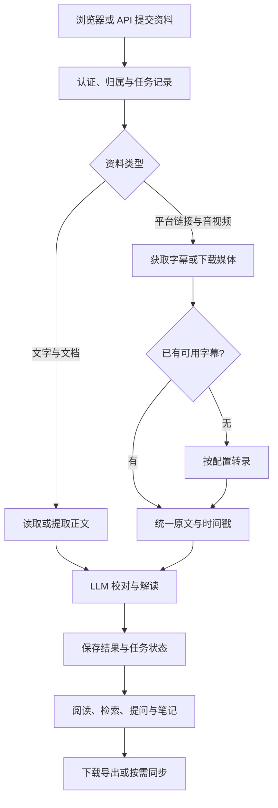

# LearnFlux 架构

LearnFlux 是一个可自托管的学习工作台：把链接、文件或文字整理成可阅读的原文与笔记，继续提问、复盘，并按需保存到自己的知识工具。

第一次使用只需要 **Python 应用、默认 SQLite 与文件存储，以及已配置的大模型 API**。从一段文字开始，不需要先安装转录模型、TikHub、PostgreSQL 或对象存储。安装步骤见 [README](../README.md#快速开始)，配置字段见 [配置指南](guides/configuration.md)。

本文描述当前工作区实现；服务是否可用仍取决于实际配置。模块存在不代表第三方账号、模型、网络和权限已经配置完成。

## 一条主链路，按来源分流



文字和文档直接进入文本处理；已有字幕的音视频可复用字幕。只有需要语音识别的媒体才进入 ASR。飞书 Wiki / Docx 也走正文读取路径，不作为媒体下载或转录。

提交和后台处理分开：浏览器负责显示进度和结果，服务中的任务队列与 LLM 队列负责继续处理。刷新或离开页面不会取消已经接收的任务。

## 模块边界

| 位置 | 负责什么 |
| --- | --- |
| `main.py`、`api/server.py`、`api/app.py` | 读取启动环境、创建 FastAPI 应用、注册路由和后台处理器。 |
| `api/routes/` | 提交资料、读取进度、展示页面、学习、阅读、复盘及设置等接口。 |
| `api/services/` | 串起来源获取、转录、LLM、任务恢复与结果交付。 |
| `downloaders/`、`document_sources/` | 获取平台内容，或在授权后读取文档正文。 |
| `transcriber/` | 转录策略、不同服务的适配、并发、报价与调用状态。 |
| `llm/` | 模型调用、校对、说话人处理、分段和总结。 |
| `cache/`、`persistence/` | 保存任务、解析结果及业务数据，适配 SQLite / PostgreSQL。 |
| `study/`、`collections/` | 单份资料学习、多资料对照、课程章节与系列解读。 |
| `reading/`、`reviews/`、`journal/` | 文档阅读、复盘与写作相关数据和操作。 |
| `exports/`、`obsidian/` | 导出和可选的外部知识工具同步。 |
| `src/web/` | 页面模板、静态页面、公共导航、样式与浏览器交互。 |

主要协调逻辑仍在 Python 应用中；无需为默认本地使用先拆成多个独立服务。队列和部分后台状态属于应用进程，不能仅增加 Web 进程数量就假设获得了协调一致的分布式任务系统。

## 来源获取与转录

来源获取和语音识别是两个不同边界：平台限制、登录或字幕获取失败，与转录服务的故障需要分别定位。

- **平台来源**：`downloaders/factory.py` 选择对应适配器。YouTube、Bilibili、抖音、小红书、小宇宙等有不同实现；部分平台需要 TikHub、Cookie、独立服务或特定网络条件。
- **本地文件与文字**：由学习接口和 `api/services/source_preservation.py` 保存来源或提取正文，不必先经过平台下载器。
- **飞书文档**：`document_sources/feishu.py` 检查配置的所有者与本机 CLI 身份后读取。缓存内容也受归属检查约束；未展开的图片或画板应在结果中说明。

转录按任务选择和配置启用，不要求同时安装以下所有服务：

| 方式 | 实现与前提 |
| --- | --- |
| 本机 Whisper | `LocalWhisperProvider` 调用配置的 `mlx_whisper` 程序。当前适配面向 Apple Silicon macOS 的 MLX Whisper；需安装可执行程序并准备模型。 |
| CapsWriter | 普通转录的另一条本地服务路径，通过 WebSocket 连接独立服务。配置模板地址为 `ws://localhost:6016`。 |
| FunASR 说话人识别 | 独立的说话人识别客户端；模板地址为 `ws://localhost:8767`。是否使用由任务选项与配置决定。 |
| 云端转录 | 当前有阿里云 FunASR 适配。默认关闭，凭据来自环境变量；新提交需要可信报价和用户确认。 |

`transcriber/transcriber.py` 保持普通转录的统一入口，适配器返回可供既有处理流程使用的结果。具体支持的音频、时间戳和说话人能力，以所选服务及测试为准。

## LLM 与带出处的学习

`llm/` 将原文交给配置的模型，完成校对与结构化解读；长内容可分段处理。模型选择、调用重试和内容降级由现有配置与客户端负责，不在每个页面重复实现。

`study/` 在已经保存的原文和解析结果上提供播放器、笔记与提问：

1. **先授权，再读资料**：单份或多份资料均检查调用者的访问范围；多资料对照先核对全部所选来源。
2. **检索有边界**：`study/body_search.py` 读取已授权正文；`study/evidence.py` 用本地词语匹配选择相关段落，不依赖额外向量数据库。
3. **保留真实位置**：进入模型的片段保留原文行号或时间戳。短资料可完整提供，长资料采用受限检索或明确说明的抽样，不把部分内容描述为全文。
4. **模型回答可核对**：回答与引用需要回到原文判断；检索命中不等于模型结论必然正确。

系列学习通过 `collections/` 管理资料与章节，组织全系列主线和章节解读。播放器是否可用还取决于媒体文件、字幕与来源是否仍可访问。

## 持久化与恢复

**新安装默认使用 SQLite 与本地文件。** `persistence/runtime.py` 读取 `LEARNFLUX_PERSISTENCE_BACKEND`；未指定时为 `sqlite`。切换 PostgreSQL 需要显式选择后端并配置 `DATABASE_URL`，不会自动替用户迁移数据。

| 数据 | 存放与边界 |
| --- | --- |
| 任务、进度与业务元数据 | 由缓存管理器和各业务仓库保存；服务端状态是进度的依据。 |
| 解析结果 | SQLite 模式主要由缓存目录保存正文和结构化文件；PostgreSQL 模式将解析产物保存到数据库并使用哈希校验。 |
| 原始媒体与文档 | 来源文件与解析结果有不同保留策略；不要把 ASR 临时目录当作永久资料库。 |
| 浏览器状态 | 保存导航偏好、部分草稿和近期查询等增强状态，不替代服务端结果与归属校验。 |

持久任务控制存储的 `updated_at` 是进度心跳依据。用户界面按北京时间展示日期，接口时间带明确偏移，保存的时间点按 UTC 处理。

服务启动时会核对可恢复任务，但恢复不等于无条件重放。`api/services/task_recovery.py` 只恢复保存了请求信息且重新通过所有者和状态检查的普通本地链接任务；上传任务、取消任务、禁用用户及云端提交不能照此盲目重试。云端状态不明时须走专门的确认与恢复逻辑，避免重复提交和计费。

PostgreSQL schema 和迁移位于 `persistence/migrations/postgres/`。迁移验收与回滚见 [PostgreSQL 指南](guides/postgresql.md)。对象存储也是单独配置的可选依赖。

## 页面、公共导航与缓存

工作台同时保留静态 HTML 页面和 Jinja 结果模板，共用同一套导航和外壳：

- `src/web/product-navigation.json` 保存菜单数据，`scripts/sync_product_navigation.py` 生成静态导航与模板片段。
- `app-shell.js` 管理导航交互；`app-shell.css` 与 `workbench-wildwood.css` 提供公共结构和主题。Jinja 页面从 `base.html` 继承，内容区的补充样式放在 `page_styles`。
- `api/assets.py` 为全部 CSS / JS 计算内容版本，运行时页面和生成脚本共用。页面不维护各自的资源文件清单。
- `api/static_files.py` 要求 HTML / CSS / JS 重新验证；Service Worker 在线获取绕过旧 HTTP 缓存，断网时保留可用的公共页面回退。API、私密结果和带私密缓存指令的响应不进入公共离线缓存。

这样，修改公共导航或主题时，可以检查同一来源，而不需要为历史页、设置页和结果页分别修一份外观。

常用入口：

| 入口 | 用途 |
| --- | --- |
| `/add_task_by_web` | 导入链接、文件或文字。 |
| `/view/{view_token}` | 查看处理进度、完成结果或错误。查看凭据应作为私密链接处理。 |
| `/study`、`/collections` | 单份资料播放与学习、系列资料组织。 |
| `/reading`、`/static/focus-studio.html`、`/review` | 阅读、写作和复盘。 |
| `/static/history.html` | 搜索并继续过去的学习任务。 |
| `/settings` | 查看和修改支持在界面中配置的项目。 |

## 按需启用的集成

| 集成 | 何时需要 | 说明 |
| --- | --- | --- |
| TikHub 与平台工具 | 导入相应社媒内容时 | 平台接入集中在下载器与配置中；获取能力受账号、网络和服务限制。 |
| Obsidian | 希望保存到本机笔记库时 | 使用配置的 Vault 和目录，并处理已有文档的修改冲突。 |
| 飞书归档 | 希望在飞书回看结果时 | 独立启用同步，保留交付状态、去重和版本保护；见 [飞书归档](guides/feishu-archive.md)。 |
| 日报 | 已有授权来源和已生成报告时 | `/briefings` 只读取发布产物，页面 GET 不同步来源、不生成报告；见 [日报指南](guides/daily-briefings.md)。 |
| 手动图解 | 用户明确点击生成时 | 可调用付费图片服务；页面打开不会生成，已保存图片不做额外模型审查；见 [图解指南](guides/image-diagrams.md)。 |
| 手机入口与通知 | 需要远程提交或结果提醒时 | 手机提交、网络入口和通知分别配置；见 [手机快捷指令](guides/mobile-shortcut.md)与[通知指南](guides/notification.md)。 |

这些集成不应成为完成第一次文字学习的前置条件。外部模型与服务可能收费，是否调用由实际操作、配置和服务规则决定。

## 开发与验证

从仓库根目录运行：

```bash
# 默认离线检查，不主动提交真实平台或模型任务
uv run --extra dev pytest

# 修改菜单或公共前端资源后同步并核对生成产物
uv run python scripts/sync_product_navigation.py
uv run python scripts/sync_product_navigation.py --check
```

更细的单元检查、需显式启用的外部验证和临时文件规则见 [测试说明](../tests/README.md)及 [AGENTS.md](../AGENTS.md)。真实第三方接口、转录模型和部署环境仍需对应的集成验证；离线测试通过不代表这些外部条件已配置成功。
