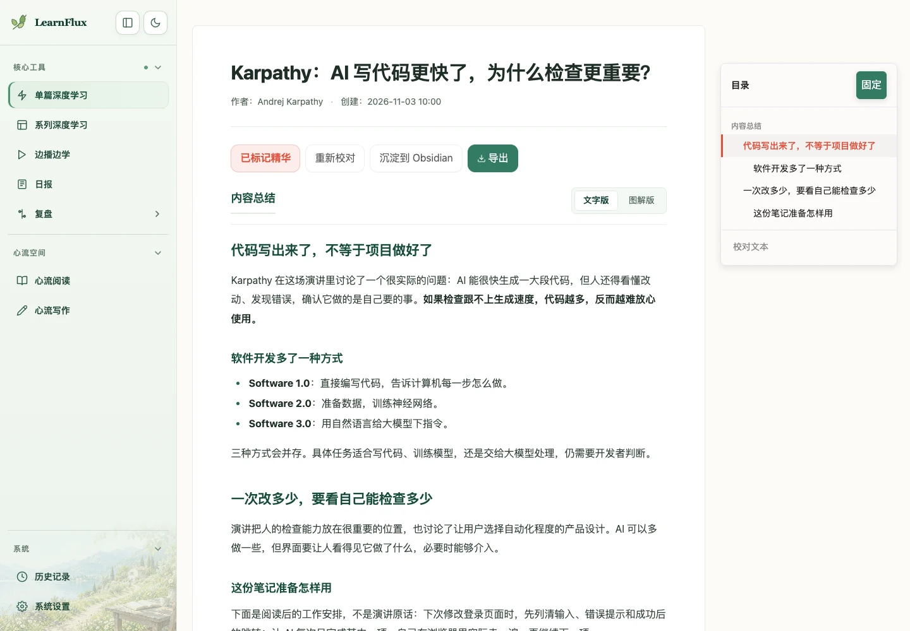
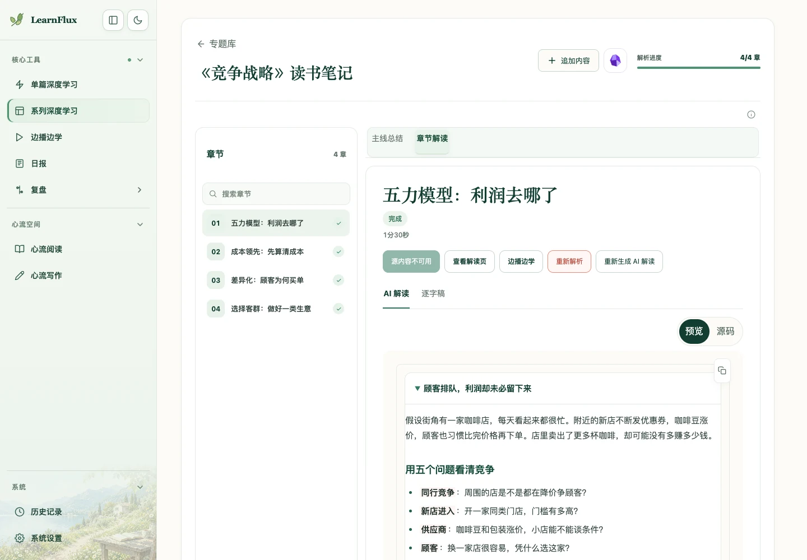
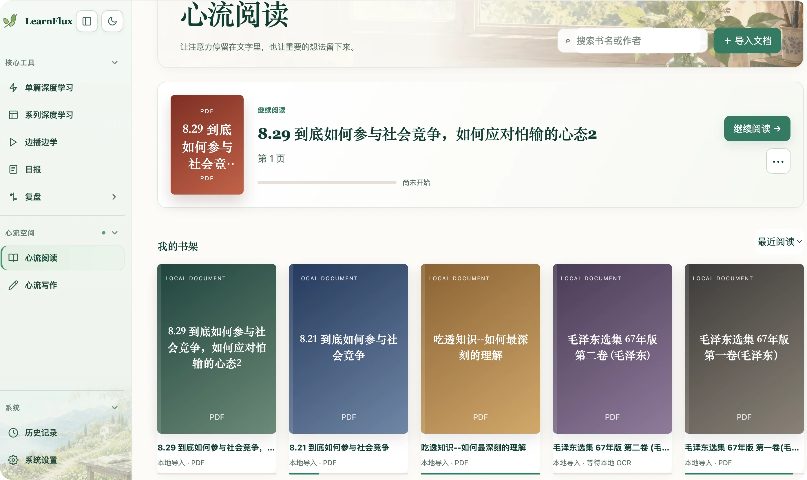
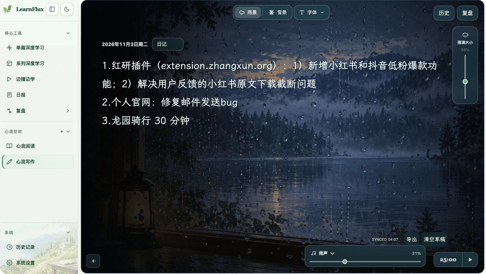

# 从第一份资料开始

LearnFlux 把资料处理、阅读和后续整理放在一个工作台里。先完成[首次安装](quickstart.md)，再按自己的任务选择入口；不需要一次配置所有服务。

| 你现在想做什么 | 打开哪里 | 完成后得到什么 |
| --- | --- | --- |
| 消化一篇视频、文章或自己的文字 | 单篇深度学习 | 原文、AI 解读和可导出的笔记 |
| 系统学习一门课或一个主题 | 系列深度学习 | 章节列表、每节解读和主线总结 |
| 一边看视频，一边核对文稿 | 边播边学 | 可定位的文稿、解读和笔记 |
| 安静地读一份文档 | 心流阅读 | 书架、阅读进度和阅读器 |
| 写日记、整理自己的想法 | 心流写作 | 自动保存的草稿与导出文件 |
| 找回学过的内容 | 历史记录 | 搜索、筛选和继续阅读入口 |
| 阅读已经生成的报告 | 日报 | 按期号整理的报告正文 |

## 先做一份学习笔记

1. 在“单篇深度学习”选择“粘贴文字”，复制[原创示例](../../examples/first-learning.md)。
2. 点击“开始学习”，在近期任务中查看处理进度。失败时先看任务错误，再核对模型设置。
3. 完成后打开结果。先读 AI 解读，再切换原文核对关键观点。
4. 有用的资料可标记精华或导出；要保存到 Obsidian / 飞书时，再配置对应集成。

“粘贴链接”和“本地文件”使用同一结果页。来源有现成文字或字幕时优先读取；需要转录时才依赖相应引擎。AI 解读需要你自己的模型服务，费用按服务商规则计算。

## 把一门课程连起来

在“系列深度学习”创建系列、添加资料，先等各章处理完成，再生成主线总结。章节解读适合逐节回看，主线总结适合梳理贯穿课程的问题与结论。

有可播放源文件的章节显示“边播边学”入口；源文件已清理或不可用时，不会提供可用播放入口。不要把有笔记等同于仍保留视频。

## 阅读、写作与回看

“心流阅读”导入 PDF、EPUB、DOCX、TXT 或 Markdown。书架为空时先导入一份文档；普通文档本地解析，不需要模型 Key。扫描 PDF 需要额外安装 OCR，页面会提示安装与重试方式。阅读器可以调整字号、主题和单页 / 双页，并保留进度。

“心流写作”可以直接开始输入，调整雨景 / 雪景、字体、音量与计时。查看保存状态后再离开；重要内容也可主动导出。“清空草稿”会清空当前编辑区，操作前先保留需要的文字。

“历史记录”用最近学习卡片帮助继续上次内容，下方的列表适合搜索和筛选。第一次安装没有历史数据，完成第一份资料后再回来查看。

## 日报与外部知识库

微信日报把授权范围内的群聊、私聊整理成重点摘要，AI 导游按兴趣和当前工作带你读公开文章与访谈。维护者用 Codex 的两项独立定时任务生成报告，再接入 LearnFlux 按日期阅读。

工作台只读取已发布成品，打开或刷新页面不会采集、生成或自动外发。新安装不附带来源项目、微信数据或已配置任务；没有对应期号时显示空状态。接入条件、身份和定时设置见[日报指南](daily-briefings.md)，新手可复制[接入提示词](../prompts/daily-briefings.md)。

同步到外部知识库前，先查看目标位置和预览。Obsidian、飞书、手机收集与转录都是可选能力，按[配置指南](configuration.md)逐项启用即可。

本文包含用户提供的本地实际使用截图和公开资料演示。演示解读为手写整理，未进行真实模型调用。[截图来源与说明](../images/readme-20261103-real/README.md)
